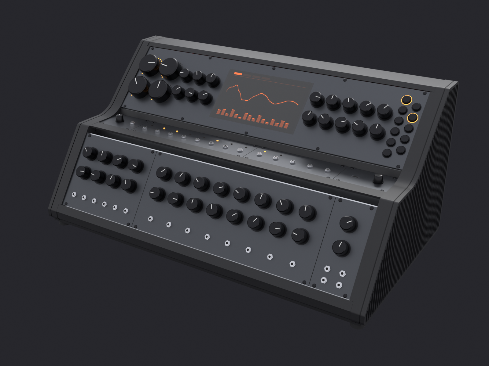

# Case SAM17 — consola de tres filas, esqueleto de aluminio y dos persianas

> **2026-10-11: la persiana.** Las dos mejillas de acrílico se van, y cada
> costado pasa a ser una **persiana**: una placa de aluminio anodizado en negro
> de 6 mm, por fuera del anillo y tapándolo, con **44 varillas verticales de
> 2 mm** atadas por dentro a dos alturas. Es por donde respira el instrumento
> (18 828 mm² abiertos por costado detrás de la ventana real) y lo único que se
> ve de él de lado, además de los paneles. Se pone y se quita sin herramienta:
> **diez tacos** de Ø8 × 3.5 en su dorso entran en diez bolsillos de la cara
> del anillo, y **20 pares de imanes** N42 de Ø6 la sostienen. Todo el aluminio
> que se ve va en negro, con una aleación (6082) y un lote; la trasera sigue
> siendo ámbar. En el render, la fila del valle ya lleva sus paneles (reparto
> provisional). Este bloque sustituye la geometría del costado de los bloques
> de abajo, que se conservan como historia. Diseño, firmas y cifras:
> [`../docs/superpowers/specs/2026-10-11-case-persiana-design.md`](../docs/superpowers/specs/2026-10-11-case-persiana-design.md);
> taller, [`PLIEGO.md`](PLIEGO.md) §6.3 a §6.5.
>
> 
>
> | | |
> |---|---|
> | persiana ×2 | aluminio 6082-T651, pletina de 12 frenteada a 9.5; 44 varillas de 2, borde de 4 y dos atados; un par espejado |
> | tacos | diez por persiana, Ø8 × 3.5, del mismo bloque; dos localizan (Ø8 H7 y una colisa de 8 × 10) |
> | imanes | 20 pares N42 Ø6: 16 de Ø6 × 3 con Ø6 × 2, y 4 finos de Ø6 × 1 + Ø6 × 1 en el tramo de atrás |
>
> **Estado:** en el modelo y con sus puertas (`guarda_persiana()`,
> `guarda_tacos_persiana()`, `anillo_tiene_bolsillos()`, y las cajas de la
> persiana en `solapes()`); sin fabricar. El aire se cuenta con el plano neutro,
> la potencia de la v5 y la base como entrada: 14,3 K sobre la sala (16,2 en el
> pesimista), contra un techo de 20. **La tabla de nogal ya es una base de chapa
> de 3 mm** (papel `docs/superpowers/specs/2026-10-12-case-suelo-design.md`,
> acta 4): bajo los anillos, con 1118 agujeros de Ø5 y los M4 de nariz y talón
> desde abajo; el chasis de la fuente se queda encima. Lo siguiente es la tira
> de muestra (#398). Dos decisiones
> abiertas: con diez tacos el tramo más largo sin taco mide 112 mm y el papel
> pide 100 (once lo bajan a 92), y el doblez R3 de la tapa del valle en
> 6082-T6.

> **2026-08-30: tanda A, techo macizo y tres chapas empotradas.** El techo
> pierde las ranuras. La salida de aire pasa a la rendija bajo el alero. Techo,
> nariz y talón entran en un rebaje de la cara interior de los anillos; los
> pies siguen apoyados en la tabla. La tabla entra con el anillo B y el chasis
> del PSU entra al final por el frente. Este bloque sustituye la geometría y el
> orden operativos del bloque del 2026-08-29 que sigue; aquel se conserva como
> historia de la decisión. Diseño y puertas:
> [`../docs/superpowers/specs/2026-08-30-techo-macizo-chapas-empotradas-design.md`](../docs/superpowers/specs/2026-08-30-techo-macizo-chapas-empotradas-design.md).

> **2026-08-29, más noche: la trasera capturada como las mejillas, y el
> talón como la nariz.** Samuel, mirando el render: la relación del acrílico
> con el metal atrás tenía que ser la de las mejillas, y el talón tener el
> estilo de la nariz. Ahora **la trasera va DENTRO de un bolsillo fresado en
> el tramo trasero de cada anillo** — labio 3, 6 de hondo, 11 de ancho: los
> números del bolsillo del costado, girados — con su cara rehundida 4 sobre
> junta de EPDM, **sin un taladro** (552.32 × 237.18); el bolsillo está
> **cerrado por los dos extremos** (nada a la vista en ningún canto) y la
> plancha **entra al montar el segundo anillo**, como los costados — las tres
> planchas se montan una vez, con el case —; su arista de abajo-fuera va a
> chaflán de 5.5 para librar el escalón del bolsillo bajo el chaflán de P6. Para
> que quepan los dos bolsillos en los 20 de franja, en ese tramo el costado
> entra 3 y no 6 (queda una pared de 3 entre ambos). **El talón es la nariz de
> atrás**: P6 a chaflán 6, pie de 20 sobre la tabla (3 M4 avellanados desde
> dentro), chaflán y labio de 13, más **ocho pestañas** lanzadas del pie que
> le hacen de tope a la trasera por dentro — y son estructura: la plancha sola
> en sus bolsillos cede 20 mm con la mano y trabaja a 14 MPa; con las pestañas
> a su aire de 3.5, la mano barrida por todo lo visible queda en 8.9
> (`guarda_trasera_flexion()`). **El techo baja con chaflán + labio de 18** (variante B,
> la que Samuel escogió el 2026-08-30 mirando los dos renders; la A era la
> banda de 24 y sigue en el modelo hasta que se retire).
> 68 tornillos → 58, 10 cabezas atrás → **0**, la tapa de arriba sigue en
> 180°. Todo en
> [`../docs/superpowers/specs/2026-08-29-trasera-capturada-talon-nariz-design.md`](../docs/superpowers/specs/2026-08-29-trasera-capturada-talon-nariz-design.md).
> Lo que las puertas obligaron y va escrito allí: sin canal en el techo (en
> una chapa el labio no puede tapar el canto Y tener retorno), el labio del
> techo a 18 porque solo aguanta la mano (176 MPa con 13), y la pata trasera
> del marco a 28 (129 MPa contra 130 con 26). Y lo que el revisor del PR cazó:
> el bolsillo salía por abajo y la plancha no pasaba por la boca estrecha del
> chaflán — de ahí el bolsillo cerrado y la entrada con el anillo. Queda un
> hueco declarado: empujada en los 75 mm de arriba de su campo visible (por
> encima de y = 157) nada la para hacia dentro y trabaja hasta a 15 MPa.

> **2026-08-29 por la noche: cinco piezas en cuestión, cuatro que quedan.**
> Samuel puso en cuestión `clips_costado`, `escuadras_trasera`,
> `marcos_trasera`, `miembro_alto` y `miembro_bajo` «al mejor estilo japonés»:
> una pieza se queda solo si hace un trabajo que ninguna vecina puede hacer.
> Con esa vara: **las tres placas de anclaje, los dos clips y la escuadra de
> cada costado son UN marco de la ventana** (`marco_ventana`, pletina de 6
> con el contorno de la ventana, corrida por los siete tramos: ata los seis
> rieles y retiene el acrílico hacia dentro por todo el perímetro); **los dos
> marcos de la trasera desaparecen** porque la meseta llega al plano trasero
> y dobla 24 hacia abajo — la banda vista ES el alma del miembro alto, el
> techo es una chapa del pico al canto sin costura —; **el miembro bajo es el
> `talon`**, un ángulo sobre la tabla como la nariz, sin bridas; la trasera
> va **dentro** de las dos bandas y sale por abajo; y el chasis del PSU se
> atornilla **a la tabla** (sus dos M5 apuntaban a la ranura de un 2020
> muerto el 27-08). 16 piezas → 4, 73 tornillos → 68, 16 cabezas atrás → 10
> sobre metal, 14 roscas por anillo (eran 16). Lo que cuesta: 0.28 kg, la
> trasera ya no sale por atrás, la banda mide 24 y no 20 para que la L se
> sostenga sola. Todo en
> [`../docs/superpowers/specs/2026-08-29-marco-ventana-banda-estructural-design.md`](../docs/superpowers/specs/2026-08-29-marco-ventana-banda-estructural-design.md).
> **Y una regla que el marco de la mañana rompía**: nada fijo a distancia
> fija delante de un acrílico de ±1.2 (`guarda_trasera_dentro()`).

> **2026-08-29, tres notas de Samuel sobre el aluminio, mirando el case en
> Blender.** (1) **La bahía se va**: en el valle solo van los dos Z-Rails 1U,
> arrimados al frente de su ventana; el interior queda abierto para los tiles.
> (2) **La nariz es recta**: chaflán a 45° de 6 mm abajo, frente vertical de
> 13, y una banda nueva de chapa de 1.5 — la **`nariz`** — que cierra el frente
> de la tabla al panel, atornillada a la tabla desde dentro. (3) **La meseta
> llega al pico** (`prof_sup` 27.5 → 40.5, muere `inset_remate_frente`) y dobla
> 4 mm sobre la cara de arriba: el riel-eje deja de asomar. Y una regla nueva
> para las esquinas del anillo que llevan chapa encima: `radio_chapa` = 4.5, el
> radio exterior del doblez. Todo en
> [`../docs/superpowers/specs/2026-08-29-nariz-recta-valle-limpio-design.md`](../docs/superpowers/specs/2026-08-29-nariz-recta-valle-limpio-design.md).
> Ese hueco se cierra en la Tanda B del 31-08: la banda se prolonga 2 mm sobre
> el primer Z-Rail KONDOR y entrega la carga por una tira anti-ruido oculta de
> 0.20 mm nominal, comprimida a 0.10. `guarda_valle()` ya es un assert: con una
> mano de 200 N la tira conservadora de 50 mm queda por debajo de flecha y
> fluencia; desaparecen los 213 mm / 27 N de la viga entre pestañas.
>
> **2026-08-31, Tanda B.** La fila del valle deja de fingir compatibilidad
> Intellijel: es la **fila auxiliar KONDOR de 55 mm**, 49 mm entre centros. El
> primer riel queda fijo y solo el segundo se mueve 15.35 mm; el valle crece
> 12.35 y el fondo pasa a **319.76 mm**. Los paneles de las tres filas y sus
> rieles se rehundieron juntos **1.50 mm**; anillo y marco no se mueven y forman
> el borde visible. Las tres caras de panel son **fijas**: no hay bisagras,
> barrido ni ángulo mínimo de apertura.
> Diseño y mutaciones en
> [`../docs/superpowers/specs/2026-08-31-case-tanda-b-design.md`](../docs/superpowers/specs/2026-08-31-case-tanda-b-design.md).
>
> Para señalar una pieza sin adivinar: `renders/piezas.py` arma
> `build/sam17-piezas.blend` con **cada pieza como objeto con el nombre del
> repo** (`nariz`, `miembro_alto`, `tapa_valle`...). Clic en la pieza, nombre en
> el Outliner.

> **La costilla dejó de ser chapa plegada el 2026-08-28** y pasa a ser un
> **anillo de pletina de aluminio mecanizada** (14 mm, fresado CNC, una
> pieza por lado, sin soldadura) que sigue cargando todo el case. El
> acrílico sigue siendo **piel** sin un solo taladro, ahora asentado
> COPLANAR en un rebaje detrás de la cara vista del anillo, sobre una junta
> de EPDM de 1 mm — ya no hay casquillo de aluminio ni junta de 4 mm entre
> costilla y costado. El suelo sigue siendo una **tabla de madera** que hace
> de zócalo a la vez. El diseño entero está en
> [`../docs/superpowers/specs/2026-08-28-costilla-pletina-design.md`](../docs/superpowers/specs/2026-08-28-costilla-pletina-design.md).
>
> **Histórico — el acrílico dejó de cargar el 2026-08-26.** Hasta esa fecha
> este README decía «consola en acrílico naranja» y la pieza que sostenía el
> aparato era el costado. La estructura pasó primero a chapa de aluminio
> plegada
> ([`...2026-08-26-case-esqueleto-aluminio-design.md`](../docs/superpowers/specs/2026-08-26-case-esqueleto-aluminio-design.md))
> y de ahí, el 2026-08-28, a la pletina mecanizada de arriba.

Spec: [`docs/superpowers/specs/2026-08-15-case-design.md`](../docs/superpowers/specs/2026-08-15-case-design.md) (rev. 28)
Board de intención: [`renders/propuesta-diseno-2026-08-16.png`](renders/propuesta-diseno-2026-08-16.png)
— **manda sobre lenguaje visual, NO sobre cotas**: se dibujó para paneles de
190 mm y un case de 500 × 380 × 350, y el case real mide 580.62 × 256.18 × 319.76
con las persianas (568.62 de anillo a anillo).

## Formato: EUROrack 3U, las dos filas

**Este apartado decía lo contrario hasta el 2026-08-17.** Decía que el SAM17
usaba formato propio de 190 mm y que no era intercambiable con Eurorack. Se
revirtió: las dos filas son **3U de EUROrack** — `alto_panel_inf` =
`alto_panel_sup` = **128.5 mm** ([`cad/params.scad`](cad/params.scad)), paso
de 1 HP = 5.08 mm, y `sep_railes` = **122.5 mm** entre centros, que es la
cota del panel (ranuras a 3.0 mm de cada canto), no del riel.

Los raíles son **Z-Rails de Tiptop de 104 HP** (528.3 mm), comprados el
2026-08-18. Llevan pletina roscada M3 continua, así que la separación la
pone el costado al taladrarse, no el riel.

La tercera fila, en el valle, es **KONDOR de 55 mm**. Usa los mismos Z-Rails,
104 HP y `inset_er` de 3 mm, pero su separación vertical de **49 mm** es propia:
no es Intellijel 1U ni se anuncia como compatible. Los tres paneles están
rehundidos **1.50 mm** respecto del anillo y el marco; panel y riel se desplazan
juntos para que el dorso siga apoyando en la cara del Z-Rail.

Consecuencia: cualquier jack, perilla, panel ciego y módulo Eurorack
comercial encaja. Lo que se perdió es la proporción del board de intención,
que se dibujó para 190 mm.

**Dimensiones** (salida real de `clearance_budget.py`, `perfil()`):

| | |
|---|---|
| ancho total | **568.62 mm** = `ancho_util` + 2 × `t_anillo` (2026-08-28; era 544.32 con la costilla de chapa) |
| alto total | **256.18 mm** |
| fondo | **319.76 mm** (bbox de `costilla_2d`; +12.35 por la fila KONDOR de 55) |
| altura de entrepiso | **146.58 mm** |
| ancho útil entre anillos | **540.62 mm** = `largo_riel` + `hol_riel` + 2 × `t_placa` (donde van rieles y miembros; era 528.32 antes del marco de la ventana, que hereda `t_placa`) |

**El suelo cierra, y cuesta 8.46 mm de alto** (2026-08-21). La bandeja de base
llegaba solo hasta el larguero de base delantera, que a su vez se retira por
detrás del raíl de panel para que ese raíl pueda bajar hasta la esquina. El
resultado eran **37.96 mm de suelo abierto** por delante — que no era un
descuido: era la entrada de aire.

Cerrarlo no era estirar la plancha. El Z-Rail de abajo va girado 35° y su
esquina baja caía en **y = 4.84**, o sea 3.16 mm *por debajo* del techo de la
bandeja (y = 8): ninguna plancha plana le pasa por debajo. Hubo que subir el
raíl, y `alto_frontal` no viaja solo — la punta redondeada se come
`alto_frontal/2` de cara, así que arrastra `inset_inf_frente`, que va dentro de
`alto_cara_inf`, que es quien fija el fondo:

| | antes | ahora |
|---|---|---|
| `alto_frontal` | 13 | **19** |
| `inset_inf_frente` | 14.5 | **17.5** |
| `alto_cara_inf` (derivado) | 152.75 | **155.75** |
| esquina del raíl | y = 4.84 | **y = 13.29** (5.29 de aire) |
| alto del case | 247.73 | **256.18** |
| fondo | 307.22 | **308.94** |

Es exactamente el precio que el propio `params.scad` había anotado cuando se
hizo el trato al revés: «subir el riel cuesta 8 mm de aparato». Se paga entero.

Por debajo ya no queda hueco: la plancha llega hasta donde **muere la curva** de
la esquina inferior delantera (x = 9.49), que es la misma regla que usa
`x_valle()` para el pico. Lo único abierto es el propio redondeo, y eso se lee
como esquina, no como ranura.

**Y la entrada de aire se queda abajo del todo en la trasera.** Se mudó cuatro
veces el mismo día y el paseo vale la pena, porque cada mudanza cerró una
pregunta:

| | dónde | por qué se fue |
|---|---|---|
| 1 | hueco de 37.96 mm en el suelo | no era diseño, era lo que sobraba |
| 2 | trasera, abajo | al cerrar el suelo hubo que dibujarla |
| 3 | suelo, en el vuelo de la bandeja | Samuel dejó la trasera con sus ondas |
| **4** | **trasera otra vez** | en el vuelo **se veía** |

La tercera murió por una razón que no sale en ningún número: el acrílico naranja
es **traslúcido**, y el campo de ranuras se transparentaba a lo largo del canto
inferior. Se ve en el render oficial, no en la geometría.

La rejilla tuvo otras cuentas y luego 44 ranuras al entrar la escuadra de la
trasera. Esa cifra queda como historia. La tanda del 2026-08-30 recalcula el
campo contra la trasera visible y deja **46 ranuras de 41.8 × 3.75**, con
**7 065 mm² a y = 46**. `ranuras_rejilla_entrada()` cruza el presupuesto con el
DXF: el área no se acepta por prosa, tiene que estar cortada.

El hueco del IEC sigue dentro de ese campo. Se saltan sus columnas enteras;
partir una ranura con el recorte dejaría un diente de PMMA, que es donde la
plancha rompe.

La rejilla y las ondas se separan **14.00 mm**. Eran 4 —`vent_puente_min`, el
mínimo por fragilidad— y los dos campos se leían como uno. `vent_puente_min`
ya no vale 4: aquel mínimo se medía contra la tapa del valle cuando era
acrílico de 5 mm (0.8 × 5 = 4); desde `b799e8b` la regla mide 0.8·t contra la
trasera de 8 mm de PMMA y subió a **6.5**, con la ranura de la rejilla
bajando a 3.75 para pagar la diferencia. Subir la onda sola no
lo arreglaba: el borde de la rejilla estaba *derivado* de la onda, así que subía
con ella y la separación se quedaba clavada en el mínimo. Se movieron las dos:
`y_bajas` 0.32 → **0.37** del vano entre filas, y la separación pasa a ser un
parámetro de dibujo propio (`vent_separacion`) en vez del mínimo de fragilidad.

Se mide **entre bordes de material**, no contra la polilínea de la onda: la onda
es un hull de círculos y asoma medio ancho de ranura por debajo de su polilínea.
La primera versión se olvidó ese término y los 14 salieron 12.

| | área abierta | altura | ranuras |
|---|---|---|---|
| entrada (trasera, abajo) | **7 065 mm²** | y = 46 | 46 de 41.8 × 3.75 |
| entrada — la base (abajo) | **21 952 mm²**, en serie con la rendija de las patas y el canal de debajo | y = 0 | 1118 de Ø5 cada 8, en L (papel del suelo) |
| salida — rendija bajo el alero | **1 442 mm²** | y = 238 | luz nominal 4.0, 3.20 comprimida, mirando al suelo |
| salida — las dos ondas abiertas | 2 289 mm² | — | — |

La meseta queda **maciza**: se retiran sus 16 ranuras porque una cara sensible
a derrames no puede ser la salida. La salida total es **3 731 mm²**: los
**1 442 mm²** de la rendija más los **2 289 mm²** de las dos ondas. La rendija
está arriba y mira al suelo; reemplaza la salida de la meseta sin abrir el
techo.

**`guarda_aire()` dejó de medir área y pasa a medir salto térmico.** Nació
exigiendo «entrada ≥ salida», que valía mientras la entrada estaba en la
trasera. Al mudarse al suelo esa desigualdad se rompe *a propósito*, y mantener
el assert habría sido tener una puerta roja sobre un diseño correcto — el vicio
que ya costó una tanda entera en este repo. Lo que hay que exigir no es paridad
de áreas: es que el aparato no se caliente.

```
Q = C_D · A_ef · √(2 g h ΔT / T)        caudal
P = ρ · c_p · Q · ΔT                    calor que se lleva
⇒  P = k · ΔT^1.5,  k = ρ·c_p·C_D·A_ef·√(2 g h / T)
```

`A_ef` son entrada y salida **en serie**; `h`, la distancia entre sus
centroides. Hoy el tiro es **105 mm** y el área efectiva, **3 299 mm²**: esta
chimenea evacúa **12.6 W** al techo de 15 K. El coeficiente y las pérdidas
se validan en la primera unidad: la puerta cierra el orden de magnitud, no
sustituye el ensayo.

**Y desde el 2026-09-03 esa cuenta no cierra, a propósito.** `potencia_disipada`
dejó de ser el chasis del PSU (**9.22 W**, que daban 12.2 K contra el techo) y
pasa a ser todo lo que se enciende dentro del cajón: **151.55 W** = 31.25 del
recinto de la fuente v4 + 120.3 de la fila de invitados y el digital (papel de
la fuente v4 §6, tras D-F1 y D-F7). Con eso el case subiría **77 K**, así que
`guarda_aire()` **ya no asevera el techo: publica el déficit como HUECO** —el
mismo patrón de `guarda_trasera_flexion()`— con el área que hace falta:
**38 664 mm² de venteo efectivo, 35 365 más que hoy** (29 395 si se descuenta
lo que se lleva la pared exterior, 22.8 W con `U = 3 W/m²K` supuesto; 42 394
con `C_D = 0.55`). Y menos si el venteo nuevo sube el tiro, que va con la
**raíz** de la altura y hoy son 105 mm en un case de 256. La obra que lo cierra
es del papel del case —**D-F3 = A**, ventilar por convección natural sin
ventilador— y vive en **#289**, no en esta puerta.
**Desde el 2026-10-12 la puerta vuelve a juzgar**: con la fuente v5 afuera
(64,22 W) y el aire contado con el plano neutro y las dos persianas, el case sube
16,9 K contra 20. **Y desde el papel del suelo (2026-10-12) la base respira**:
14,3 K, 16,2 en el pesimista. La sala de 45 °C pasa (17,6) y un costado tapado
no (21,4): los costados siguen libres. Lo que queda abierto es el HUECO de la
holgura de los costados y la hoja de la pata.

**Corrección del 2026-08-30, tras la revisión adversarial.** La primera cuenta
escogía **3.0 mm** por capilaridad. Conservaba esa razón, pero `guarda_aire()`
calculaba el área con la luz nominal mientras `guarda_rendija()` ya usaba la
comprimida. Con la luz comprimida en las dos puertas, 3.0 dejaba **0.2 K** de
margen contra el techo de 15: no es margen. La rendija sube a **4.0 mm**
nominales y **3.20 mm** con los tacos comprimidos un 20 %. Quedan **1.4 K** en
el aviso térmico. Además, la capilaridad mejora porque la subida va con `1/d`:
el agua sube **4.7 mm**. El labio tapa **8.5 mm** del canto de la trasera y
quedan **3.8 mm** de margen; se piden **2 mm**. Lo que cuesta: el rebaje se
ensancha a **4.5 mm** —la fresa de Ø3 sigue entrando—, la trasera retrocede 1
mm y la franja del tramo trasero pasa de **22 a 23 mm**. Desde el lado se ve 1
mm más de aluminio.

## El espacio de los módulos lo comía el chasis, no la barra

Samuel quiso retirar el larguero de base delantera: se leía pegado al raíl de
panel (4.00 mm, la holgura clavada) y parecía comerle fondo a los módulos de la
fila de abajo. Medido a lo largo del panel —y no por caja, que es donde se
esconde el error—, el limitante era otro.

El **chasis de acero del PSU** mide 176.6 × 93 mm y se sentaba *centrado* entre
los dos largueros de base. Los módulos de la fila inferior cuelgan del panel
hacia dentro y hacia abajo, y se metían en su esquina delantera-alta: el fondo
libre caía a **18.6 mm** a media altura del panel. Nadie había decidido que el
chasis fuera centrado — `ch_pos()` simplemente lo centraba.

| | mínimo | quién lo pone | panel útil a 50 mm | a 60 mm |
|---|---|---|---|---|
| antes | 18.6 mm | chasis | 27 % | 11 % |
| solo quitar el larguero | 18.6 mm | chasis | 42 % | 20 % |
| solo mover el chasis | 25.8 mm | el larguero | 53 % | 37 % |
| **los dos atrás** | **34.4 mm** | chasis | **68 %** | 42 % |

Así que ahora **el chasis se pega al larguero trasero y el delantero se pega al
chasis**, los dos a `chasis_holgura_larguero`. Una sola cadena y en un solo
sentido: `x_tr → chasis → base delantera`. El larguero acaba en x = 88.34, o sea
a **42.7 mm del raíl de panel** en vez de a 4.00 — que era la otra mitad de lo
que molestaba.

**No se retira.** Sostiene la fila delantera de tornillos de la bandeja; sin él
la plancha queda en voladizo de 280 mm bajo el chasis, y los 4 puntos de panel
que se ganarían a 60 mm de fondo no pagan eso.

Efecto colateral: el vuelo de la bandeja pasa de 30.19 a **68.85 mm**. Mientras
la rejilla de entrada vivió ahí creció con él —está derivada del vuelo, no de un
número a mano— y el salto térmico bajó a 4.6 K. Al volver la rejilla a la
trasera, el vuelo se queda de plancha maciza: 68.85 mm de suelo continuo por
delante del larguero.

Lo que dejó de salir solo: la holgura contra el raíl de panel. Estaba garantizada
por construcción mientras el larguero se *derivaba* del raíl; ahora es una
consecuencia, así que `guarda_piso()` la exige explícitamente.

**Y desde el 2026-08-29 la punta ya no es redonda.** Lo de arriba sobre «la
punta redondeada se come `alto_frontal/2`» es historia: `radio_punta` murió y la
esquina de abajo-delante lleva un **chaflán a 45° de `chaflan_nariz` = 6** y un
frente vertical de 13, con las esquinas al radio de la chapa (`radio_chapa` =
4.5). Encima va la **`nariz`**: chapa de 1.5 doblada sobre esa esquina — pie de
18 sobre la tabla, chaflán, frente y 10.27 mm subiendo por la cara de abajo
hasta justo debajo de la placa de anclaje, que se retira 9 mm para dejarle
sitio (`retiro_placa_inf`) — y atornillada a la **tabla** desde dentro con tres
Se para debajo de la cara del riel fijo: quedan 2.2 mm de aire más los 2 del
labio del riel bajo el panel. Lo mide `guarda_nariz()` como holgura estática.
**Desde el 2026-10-11 (ficha 6) ya no se para ahí**: `retiro_placa_inf` pasa a
11.9 y la nariz baja hasta pisar 1 mm de la cara del riel, a 1 mm del panel, y
la rendija se cierra. Esa regla de aire era del barrido, cuando las filas
giraban; lo mide `guarda_labio_chapas()`.

**La punta de arriba es cuadrada** (2026-08-21). El techo lleva una meseta de
`marco_remate` = **50 mm** rematada por dos quiebres de 2 mm, en vez de la
cúpula que salía antes. Fue 34 unas horas: subió a 42 cuando la meseta tuvo
que alojar el larguero del remate trasero (abajo). Son **dos** parámetros y no uno: los vértices 4 y 5
dejaron de compartir `radio_punta` —que va sobredimensionado a propósito y se
recorta a lo que quepa en la arista, o sea a `marco_remate/2`— y estrenan
`radio_remate` = 2. Subir solo el marco **engorda** el round en vez de
cuadrarlo: de 9 mm de tangente a 17.

**`radio_remate` murió el 2026-08-29.** Las dos esquinas del techo llevan
`radio_chapa` = 4.5, el radio exterior del doblez de la chapa que las cubre —
el retorno de la meseta delante, el marco de la trasera detrás. Una esquina
viva del anillo bajo un doblez a 90° asomaba 1.9 mm por fuera de la chapa.

Los 16 mm de fondo que costó relajaron las cotas más apretadas del presupuesto.
Las antiguas cifras de apertura de 2026-08-21/27 quedan anuladas por la decisión
de paneles fijos y ya no salen de `clearance_budget.py`. El efecto dimensional
que sí permanece es que el chasis del PSU pasa de 3.33 a
**11.33 mm** contra los largueros de base —era «la cota más justa del
montaje»— y el fondo libre de la bandeja sube de 46.7 a 62.7 mm.

**La trasera es UNA plancha de 8 mm, empotrada y sellada** (2026-08-21). Fueron
**dos pieles de 5 mm flotando**: colgaban de doce separadores, con su cara
exterior 10 mm por detrás del canto de los costados y 5 mm de aire por los
cuatro lados — la junta de sombra. Estaban partidas a la altura del entrepiso
porque cada una se atornillaba a los dos largueros de su piso; al morir esa
bandeja la frontera dejó de existir. Se empotra entre los dos anillos con
`hol_piel` = 0.15 mm por lado de holgura de montaje.

**Y desde el 2026-08-29 ya no es la pieza más exterior de esa cara: se rehunde
`t_costilla` y la enmarca el metal** (#234). Su cara exterior caía exactamente
en el plano trasero, y con ella caían sus dos cantos: el superior y el inferior
corrían **540 mm cada uno sin un milímetro de metal encima**. El de arriba era
además los últimos 8 mm del **pico** del case — `guarda_remate()` repartía esa
meseta entre `inset_remate_frente` + `prof_sup` + `t_piel`, y ese `t_piel` era,
con todas sus letras, el canto del acrílico haciendo de superficie vista.

Lo que asoma ahora al plano trasero son **dos bandas de chapa de 1.5**, las
mismas de los miembros:

- **arriba**, un angular: banda vista de 20 mm y un ala de 9.5 que dobla sobre
  el canto superior del acrílico y **muere en el doblez de la meseta**, con la
  que queda coplanar. El pico pasa a ser metal de punta a punta.
- **abajo**, una pletina plana de 20. Sin ala, y no es un olvido: ese canto
  está en el plano del suelo y debajo tiene la tabla, no aire — un ala ahí
  levantaría el case de su propia base.

Las dos cuelgan de las filas de M3 que la plancha **ya** llevaba a sus dos
miembros: cero taladros nuevos en el acrílico, tornillos 1.5 mm más largos, y
las diez cabezas que se veían sobre el PMMA pasan a verse sobre metal.

Lo que se pagó entonces: `prof_sup` bajó de 29 a 27.5 para no tocar el inset.
**Superado el mismo día por la tarde:** ese acantilado pertenecía a la meseta
de acrílico de 8 apoyada en el riel. Con chapa de 1.5 la meseta **llega al pico**,
`inset_remate_frente` muere y el riel fijo que asomaba queda tapado. En el pico
la chapa **dobla 4 mm hacia abajo**
por la cara de arriba (`retorno_meseta`): el canto libre de 528 mm deja de
ondular y de leerse como repisa. `guarda_retorno_meseta()` exige ahora **4 mm
de margen estático** al panel/riel fijo. Línea de sombra: 6 mm (2 de labio + 4
de aire). **Desde el 2026-10-11 son 9 mm** (ficha 6): el retorno baja hasta
pisar 1 mm de la cara del riel y deja 1 de sombra sobre el panel, y el margen de
4 murió con el barrido (`guarda_labio_chapas()`); `guarda_retorno_meseta()` se
retiró con él.

Lo vigila `guarda_marco_trasera()`, y lo primero que exige es justo lo del
issue: que el ala de arriba tape el canto **entero** y muera en el doblez, sin
rendija.

**Y baja hasta el suelo** (2026-08-22). Su canto inferior estaba en y = 3 y el
plano del piso es y = 0: quedaba un rebaje corrido de **528 × 3 × 8 mm** a lo
largo de todo el canto trasero. No era fuga —el canto de la bandeja lo cierra
8 mm adentro— pero era una **junta de sombra**, justo el lenguaje que esta pieza
enterró al empotrarse, y por eso la plancha se leía colgada en vez de asentada.

Venía de un `- 15` sin derivar copiado en cinco sitios (dos en el `.scad`, tres
en `clearance_budget.py`): era la distancia al canto de la fila de M3, leída
como si fuera una cota del case. Ese 15 no sabía dónde estaba el suelo. Ahora el
canto es **y = 0**, el mismo datum del que cuelga la bandeja de base, y lo exige
`guarda_piso()` en su cuarto assert — ninguna otra puerta lo miraba: `solapes()`
no canta porque no hay solape, y `alineacion()`/`apoyo()` solo ven filas de
agujeros.

Lo que costó: la plancha pasó de 245.18 a **248.18 mm** de alto — ese número
es de aquel día. La meseta integrándose en el miembro (27-08) la llevó a
540.32 × 254.68, y el 2026-10-12 mide **552.32 × 237.18** (`piel_trasera_2d`).
Lo que NO se
movió, y se verificó con la salida de la puerta byte a byte contra la de antes:
las tres ondas, la rejilla de entrada, el área abierta y los 6.6 K. Van
derivadas de `f_base` y `f_tras`, que son diferencias contra `ce[].y`, así que
no dependen del canto. Y la fila de M3 de abajo se **aleja** del canto, de 15 a
18 mm: más material alrededor del tornillo, no menos.

Para que enrase, **los largueros traseros comparten X**
(`x_tr = fondo − rail/2 − t_piel`), y la plancha atornillada sobre su cara
remata en el canto. El de base estaba 14 mm más adelante que los otros tres, y
por ahí se había colado un fallo real: la fila de abajo de la piel de abajo pedía
un separador de 19 mm mientras el BOM listaba los de 5. Lo caza ahora `apoyo()`
en `clearance_budget.py`, la puerta nueva que exige que **todas las filas de una
placa apoyen a la misma distancia** de la cara de su larguero — porque el
separador de una placa es uno solo. `alineacion()` solo miraba un eje.

**Y la barra del medio se va** (2026-08-25). El larguero de **entrepiso
delantero** cruzaba el centro del volumen —centro en x = 200.32, y = 131.58, o
sea 25.95 mm por detrás y 17.55 por debajo del riel de abajo de la fila de
arriba— y era **el único larguero del case que no sostenía ninguna plancha**:
las seis filas de M3 van a base delantera, base trasera, valle y remate trasero.

Por eso no lo miraba ninguna puerta. `alineacion()` y `apoyo()` solo ven filas
de agujeros; `solapes()` solo verifica que las piezas no se atraviesen. Se podía
retirar y quedarse todo en verde — que es lo que hace peligroso el cambio, no el
cambio.

Su único trabajo era atar los costados a media altura, y a **esa misma altura**
(y = 131.58) ya está el del valle, 75.14 mm por delante y encima con su tapa. Es
el mismo argumento que el 2026-08-21 tumbó tres largueros de la pared trasera,
aplicado al que quedaba: una barra que no es alma de nada.

**Lo que cuesta**, medido sobre el contorno real de `costado_2d.dxf` y no
estimado. El parche de costado que queda sin apoyo se trata como placa circular
empotrada de radio `a` = distancia del punto más desasistido a su ancla más
cercana, con `D = E t³/12(1−ν²)`, E = 3 GPa, ν = 0.37, t = 8:

| | con la barra | sin ella |
|---|---|---|
| vano libre del costado | 107.9 mm | **118.9 mm** |
| flecha con 200 N | 0.31 mm | **0.38 mm** (techo 0.60) |
| tensión bajo la mano | 6.35 MPa | **6.56 MPa** (fluencia 10, #106) |
| abrir los costados donde estaba, 200 N | — | 0.303 mm en total |
| masa | — | **−228 g** |

El punto más desasistido del costado **no era el suyo, ni antes ni después**:
está en el canto trasero a media altura (x = 244, y = 128), donde además apoya
la trasera — que el modelo no cuenta, así que el número va por el lado seguro.
Las anclas acreditadas en esta cuenta conservadora son solo los cuatro M5 de
larguero: los cuatro M4 fijos de riel cargan a través del marco y no se abonan
como anclaje directo del costado. Contándolos, el vano saldría 111.3 en vez de
118.9.

**Se acota por flecha y no por tensión**, y la razón es que la tensión no es el
limitante ni de lejos: para llegar a los 10 MPa el vano tendría que valer
642 mm —más que la pieza entera—, porque en una placa empotrada la tensión crece
con el **logaritmo** del vano y la flecha con el **cuadrado**. Lo que se nota con
la mano es la flecha. Un costado que se hunde al empujarlo se siente barato
aunque no rompa nunca.

Lo vigiló `guarda_costado()` en [`check_dxf.py`](check_dxf.py) hasta el
2026-10-11, cuando la mejilla se fue con la persiana. Vivía ahí y no en el
budget porque medía sobre el **contorno y los taladros reales del DXF**, no
sobre una copia de la geometría en Python.

**Lo que este cálculo NO cubre**: el racking del cajón entero. La puerta mira
UNA pieza plana. La rigidez del vano de 528 mm sin costado central sigue siendo
la heurística que la spec §11 no ha cerrado (`n_bulkheads` = 2, «3 si el vano
flexa»), y este cambio le quita una barra. Se cierra cargando el prototipo.

**La tapa del valle pasa a aluminio** (2026-08-25). Era la plancha más floja
del case y a la vez la **única cara horizontal** — o sea donde se apoya quien se
levanta, no donde se posa la mano al parchear.

El número que lo decide es la proporción en voladizo: la tapa mide 66.5 mm de
fondo y el larguero solo la toca **20 mm**, así que **el 70 % de la pieza
vuela** — 23.24 mm a cada lado.

Ojo con el modo de carga, porque la primera cuenta salió mal: el larguero del
valle corre los 528 mm enteros, así que hacia abajo la tapa apoya en una **línea
continua**, no sobre los 5 M3. El vano entre tornillos no existe en ese modo;
los M3 solo trabajan al tirar de la tapa hacia arriba. Lo que flexa es el
voladizo transversal.

| | acrílico 5 mm | **aluminio 3 mm** |
|---|---|---|
| flecha con 200 N en 50 mm | 0.535 mm | **0.108 mm** |
| tensión | 22.3 MPa | **62.0 MPa** |
| contra su límite | 10 (fluencia PMMA) — **lo pasa** | 130 (`Rp0.2` 5754 H22) — factor **2.1** |
| fluye a | **90 N** | **420 N** |

**Las otras tres salidas están cerradas, y conviene que quede escrito para que
nadie las reintente:**

- **Acrílico de 6 mm**: descartado en la revisión histórica por un barrido que
  ya no aplica. No se reincorpora aquí: la solución vigente es aluminio de
  3 mm por rigidez, camino de carga y unificación de materiales.
- **Larguero de 30 mm** en vez de 20: entra por **0.24 mm**, que está por debajo
  de la tolerancia de la propia extrusión. Eso no es holgura, es suerte.
- **Larguero de 40 mm**: no entra. Se pasa **4.76 mm** de su ventana, que la
  fijan las esquinas giradas de los dos raíles del valle.

El aluminio resuelve por rigidez específica en vez de por espesor y devuelve
2 mm de holgura estática.

**Y no rompe el lenguaje visual**, que era la única objeción seria: los paneles
de módulo ya son **PCB de aluminio** a los dos lados de esta banda. Una tapa de
aluminio entre dos filas de aluminio se lee como que la banda central pertenece
a los paneles. En el modelo también cambió de sitio — sale de
`planchas_acrilico()` y entra en `assembly_aluminio()`, o si no el render la
pintaría translúcida y naranja, que es peor que no dibujarla.

Lo que se lleva por delante, y es ganancia: **la única línea de BOM de 5 mm**.
El cuerpo de acrílico queda con **un solo espesor**. Y `t_acrilico` se llama
ahora `t_valle`, porque el nombre viejo habría mentido sobre el material.

Efecto colateral medido: al adelgazar la tapa, el larguero del valle sube 2 mm
para seguir tocándola, y con él su M5 en el costado — que pasa de estar a 15.03
mm del canto a **13.03 mm**, o sea de 2.73 D a **2.37 D**. Sigue muy por encima
del mínimo de 1.5 D que exige `taladros_con_material()`.

**El larguero del remate, y el fin del pegamento** (2026-08-21, histórico). La tapa que cierra
la meseta del techo iba **pegada** al Z-Rail, y era la única junta irreversible
del case: ahí arriba no había larguero al que atornillarla, y esa cara del riel
es pared de 1.2 mm. Ahora hay uno — un 2020 en la arista trasera-superior, a ras
del plano trasero y con su cara de arriba a `marco_sup` del techo. **El case
entero se desatornilla.** Ese larguero es el mismo que hoy se llama **miembro
trasero alto** (perfil 2020 comprado hasta el 2026-08-27; canal de chapa
propio desde entonces) — y la tapa que ata no existe: la meseta pasó a ser
su propia ala el 2026-08-27, así que la «junta pegada, ahora desatornillable»
de este párrafo describe una pieza que ya no está, aunque el larguero sigue.

La justificación histórica de esa X usaba el barrido de una tapa y queda
superada. La geometría vigente se verifica con paneles y rieles fijos; el fondo
actual es **319.76 mm** por la fila KONDOR y sus holguras estáticas.

Y con eso **todos los largueros traseros comparten X**: una sola cota para todo
el plano de apoyo de la trasera.

**Y junto a esa pared quedan DOS, no cinco** (2026-08-21). Llegaron a ser cinco
porque fueron creciendo uno por pieza: *entrepiso trasero* por la bandeja de
entrepiso, *repisa* por la piel superior, *remate superior* por la tira de
remate pegada de canto. Las tres piezas están muertas, y los tres largueros
seguían ahí solo como filas de tornillo de la trasera. Con la trasera hecha una
plancha continua de 8 mm eso no compra rigidez: una plancha atornillada arriba y
abajo **ya es el alma de cortante** de esa cara, y mejor alma que cinco barras
sueltas. Quedan el de abajo (*base trasera*) y el de arriba (*remate trasero*).

El vano libre entre los dos es **211.73 mm**, sobre 528 de ancho y 8 de espesor:
0.15 mm de flecha con 50 N empujando en el centro, 0.6 mm si alguien se apoya
con 200 N. La cuenta es la de una viga ancha biapoyada, `δ = PL³/48EI` con
E = 3 GPa e I = 528·8³/12.

**Kerf: 0.** El proceso es **fresado CNC**, no láser (decidido el
2026-08-17). El CAM del taller compensa el radio de herramienta como parte
normal del trabajo, así que la pieza sale a la cota del dibujo. Cero no
significa «sin calibrar»: significa que no hay nada que compensar. Solo
vuelve a ser negativo si se regresa al láser.

**Ancho mínimo de panel: 15.40 mm** (= 2×`inset_tornillo` + `d_M3_paso` +
2 mm de puente — guarda de
[`panels/build_template.py`](panels/build_template.py), Task 7). Un panel
más angosto superpone los dos taladros M3 de una misma cara; la plantilla
lo rechaza citando ese mismo número, antes de dibujar nada.

## Regenerar todo

```powershell
python -m pip install ezdxf   # una vez; lo usa check_dxf.py
powershell -File cad/export.ps1
```

Lo que se manda al taller **no son solo los DXF**: van con
[`PLIEGO.md`](PLIEGO.md), que lleva material, procesos, acabados, profundidad
de cajeado y qué cara es la exterior. Un DXF suelto es media pieza. Para
elegir taller antes de pedir, [`RFQ.md`](RFQ.md).

Corre `clearance_budget.py` ANTES de exportar y `check_dxf.py` DESPUÉS —
relee los DXF tal como los verá la fresadora; si cualquiera de los dos está en
rojo, el script sale con código distinto de cero y no se exporta ni se deja
nada a medias. Los DXF van en mm; decírselo explícito al servicio de corte.

La plantilla KiCad de panel se regenera aparte, con el Python de KiCad (no
el del sistema, porque importa `pcbnew`):

```powershell
"C:/Program Files/KiCad/10.0/bin/python.exe" case/panels/build_template.py --ancho 100
```

### El naranja del render, y por qué no es una cota

`render.py` pinta el acrílico con `Base Color` **(1.0, 0.24, 0.04)**, que en
sRGB es **#FF8638**. El valor se eligió **mirando el render**, no calculándolo:
estuvo en (1.0, 0.35, 0.05) —#FFA03F, ámbar— y pasó unas horas por
(1.0, 0.16, 0.04) —#FF6F38—, que Samuel descartó el 2026-08-26 por rojo.

Se decide mirando y no con una muestra de color porque el material lleva
`Transmission Weight` = 0.85: **el tono que se percibe no es el hex plano**. Un
chip de color al lado de este render no se parecen, y el que manda es el
render.

**Y no es una cota del material.** El PMMA naranja todavía no está comprado y
su tono lo fija el proveedor, no este archivo. El día que llegue la plancha,
lo que se ajusta es el render para parecerse a ella — no al revés. Esto es
intención visual, del mismo tipo que el board de 2026-08-16: manda sobre
lenguaje, no sobre nada que se corte.

### Criterio de regeneración limpia — tres clases, no una

`export.ps1` y `build_template.py` **no** producen los mismos bytes en cada
corrida, y eso es esperado, no un fallo — un `git status` que exige
identidad byte a byte da falso rojo en dos de las tres clases de artefacto.
Verificado corriendo cada export 3 veces (el estado commiteado + 2
regeneraciones desde cero, Task 10) y comparando con SHA-256:

| Clase | ¿Byte-idéntico? | Qué SÍ es estable | Mecanismo |
|-------|:---:|---|---|
| **DXF** (`case/plans/*.dxf`) | **SÍ** | Todo — 8/8 archivos con el mismo SHA-256 en las 3 corridas (medido con 8; hoy son 16) | OpenSCAD 2021.01 emite R12 determinista para geometría 2D |
| **STL** (`case/renders/build/*.stl`) | **NO** | El tamaño en bytes: `assembly_aluminio.stl` midió 25457 B las 3 veces, `assembly_acrilico.stl` 2478678 B las 3 veces | CGAL no garantiza el orden de facetas al triangular. `assembly_aluminio.stl` cambió de SHA-256 en las 2 regeneraciones (3 hashes distintos en 3 corridas); `assembly_acrilico.stl` coincidió por azar en esta muestra — no asumir que un STL se mantiene solo porque coincidió una vez |
| **`.kicad_pcb`** (`case/panels/panel-template.kicad_pcb`) | **NO** | El *conjunto* de bloques top-level (posiciones de footprint, geometría de taladros y contorno) una vez se descartan las líneas `(uuid ...)`: 17/17 bloques idénticos en las 3 corridas, verificado por comparación estructural (no diff lineal) | KiCad reacuña un UUID nuevo por objeto en cada guardado y además **rota cíclicamente** el orden de los bloques `(footprint ...)` — un `diff` de texto sobre dos corridas muestra decenas de líneas cambiadas sin que ninguna posición real se haya movido |

**Criterio de verificación correcto por clase** (el que aplica Task 10, y el
que debe aplicar cualquier regeneración futura):

- **DXF**: `git status --short` tiene que salir vacío tras regenerar.
  Cualquier diff en un `.dxf` es un hallazgo real — algo cambió que no
  debería (`params.scad` o el propio script).
- **STL**: comparar tamaño en bytes, nunca el hash ni un diff. Un STL
  committeado que cambia de *tamaño* tras regenerar sin tocar `params.scad`
  sí es un hallazgo; un hash distinto con el mismo tamaño no lo es.
- **`.kicad_pcb`**: comparar el conjunto de bloques top-level con los
  `uuid` quitados, nunca un diff lineal ni el hash completo del archivo.

Por eso `case/renders/build/*.stl` y `case/panels/panel-template.kicad_pcb`
pueden aparecer como `M` en `git status` después de un `export.ps1` /
`build_template.py` limpios sin que haya ningún hallazgo real detrás. Antes
de investigar un diff en esos dos archivos: regenerar dos veces más y
comparar las regeneraciones *entre sí* con el criterio de su clase, no
contra lo commiteado con un diff de texto.

(Nota aparte, sin relación con lo anterior: `panel-template.kicad_pcb`
mide 7270 B recién escrito por `pcbnew` en Windows —CRLF— y 6905 B leído
del blob de git con `git show` —LF—, por `core.autocrlf=true`. Es la
misma conversión de fin de línea de siempre, no una cuarta clase de
no-determinismo.)

## Artefactos que NO van al repositorio

`case/renders/build/*.stl` se regenera con `cad/export.ps1` y **no se versiona**
(issue #48). Son ~6,6 MB que cambian entera cada vez que se mueve un milímetro,
y no aportan nada que el `.scad` no tenga: quien quiera el STL lo exporta.

`case/renders/build/vista_chasis_*.png` también: son vistas de viewport de
OpenSCAD, un segundo de regeneración cada una. Existen porque el chasis de acero
es la única pieza cuyo **interior** es el diseño, y no se ve en ningún otro
entregable — el DXF es plano y en el render del case queda detrás de los paneles
(se probó metiéndolo en `render.py`: dos PNG idénticos y minutos de Cycles).

`case/plans/lienzo_2d.dxf` va por el mismo camino: es la preview de las piezas
de acrílico en rejilla, no se manda a ningún sitio, y son otras 58.894 líneas de
diff. **El lienzo no lleva las tres piezas de acero ni la tapa del valle** y es a
propósito: van a otro taller y con otro proceso —las del chasis, corte y
plegado; la del valle, corte de chapa—, así que nestearlas con el acrílico
sería mentir sobre lo que se manda junto. La tapa salió el 2026-08-25, con el
cambio de material: hasta entonces era la tercera plancha de la segunda fila.

Lo que sí se versiona son los **diecinueve DXF que se mandan a cortar** de
`case/plans/`, contados el 2026-10-11: uno de acrílico (la trasera), tres
operaciones del anillo mecanizado (cara vista, dorso y cara de fuera, §6.1 del
pliego), tres de la persiana (§6.3),
cinco de aluminio (marco de la ventana, techo, nariz, talón y tapa del valle),
tres de acero, una de madera, el cajeado de la marca y dos cupones —el de
kerf del acrílico y el del perfil del anillo—. Son el entregable que va al
taller, y su diff es la prueba de qué se mandó a cortar y cuándo.

## Procedimiento del cupón — sólo si se vuelve al láser

**Con el proceso actual (fresado CNC) este procedimiento NO aplica y `kerf`
vale 0.** El CAM del taller compensa el radio de herramienta como parte normal
del trabajo y la pieza sale a la cota del dibujo, con la tolerancia de
producción del taller (Schaeffer publica 0.05–0.10 mm).

Se conserva entero porque el láser sigue siendo una alternativa viable, y
porque el día que se vuelva a él hay que hacer esto **dos veces, una por
espesor**: la franja del láser no es la misma en 5 que en 8 mm, y `params.scad`
tiene un único `kerf`. Ese día hay que partirlo antes de cortar nada.


1. Cortar [`plans/coupon.dxf`](plans/coupon.dxf) en el acrílico REAL con la
   máquina REAL. El cupón se dibuja CRUDO, sin kerf: es la pieza que lo mide.
   Cada escalera tiene 11 peldaños, de 0.5 mm por debajo del diámetro nominal
   del tornillo a 0.5 por encima, en pasos de 0.1 (M3: 2.5 → 3.5 dibujados).
2. **El `kerf` de `params.scad` es NEGATIVO.** Probar los tornillos M3/M4/M5
   en las escaleras y anotar el peldaño —el diámetro DIBUJADO— en el que el
   tornillo entra firme sin forzar. Ese ajuste firme se da cuando el agujero
   FÍSICO mide más o menos el diámetro nominal del tornillo (3.0 / 4.0 / 5.0),
   así que:

   ```
   canal del láser = diámetro nominal del tornillo − peldaño dibujado que ajusta
   kerf            = − canal del láser
   ```

   Ejemplo numérico completo (los números son de ejemplo, el procedimiento
   no): el M3 entra firme en el peldaño **dibujado 2.7 mm**. Un M3 entra firme
   en un agujero físico de ~3.0 mm, así que el láser se comió
   3.0 − 2.7 = **0.30 mm** de canal → `kerf = -0.30`.

   Comprobación de que el signo es el correcto, porque es el error caro: el
   modelo dibuja todo hueco como `d + kerf`. Con `kerf = -0.30`, un agujero de
   paso M3 se dibuja a 3.4 − 0.30 = 3.10 mm y sale físico a 3.10 + 0.30 =
   **3.40 mm**, que es el nominal buscado. Con `kerf = +0.30` saldría a
   **4.00 mm**: 0.6 mm de más, tornillo bailando en cada agujero de tuerca T
   de las bandejas. Si el servicio te da un kerf de tabla (siempre positivo, es
   el ancho del canal), va a `params.scad` **con el signo cambiado**;
   `clearance_budget.py` avisa en AMARILLO si el valor entra positivo.
3. Probar la ranura con el perfil 2020 y la lengüeta con arandela+tuerca,
   **apretando a `par_m3` (1.0 N·m) con destornillador dinamométrico**. La
   «sensación de tope» dejó de ser el criterio el 2026-08-24: el par sale de
   la arandela y está calculado, no se estima con la muñeca.
3b. **Confirmación anti-circular** (lección de projects/vectorizer): el kerf
    elegido en el paso 2 se confirma con un ajuste INDEPENDIENTE — la
    ranura del 2020 del paso 3 y un tornillo en una escalera DISTINTA de la
    que lo fijó. Medir los mismos agujeros que definieron el kerf siempre
    "pasa".
4. Registrar aquí: fecha, proveedor, material, espesor MEDIDO con calibre,
   máquina, kerf medido → actualizar `params.scad` y re-exportar.

| fecha | proveedor | material | espesor medido | máquina | kerf |
|-------|-----------|----------|----------------|---------|------|
| (pendiente) | | | | | |

## BOM de herrajes

Salida real de `openscad -D 'PART=\"bom\"' cad/sam17_case.scad` — los 4
`echo` del modelo (recontar tras cualquier cambio a `params.scad`):

| Pieza | Cantidad | Nota |
|-------|----------|------|
| **ANILLO** (costilla) — pletina de aluminio **FRESADA** t=14, cara vista 20 | **2** | **la pieza portante del case, mecanizada, no plegada**. Conserva el rebaje de 6 × 11 del costado, vacío desde el 2026-10-11, y el chaflán 1.5 × 45° de la cara vista; y en la cara de fuera gana **diez bolsillos** para los tacos de la persiana. En la cara interior gana el **rebaje de chapa de 4.5 de ancho × 3 de fondo, z = 11..14**, solo donde se ve techo, nariz o talón. La chapa queda rehundida 1, con 0.5 contra la pared y 2.5 agarrados en z; el **reborde de 1 × 3** tapa el canto. El radio es 5.5 donde hay chapa y vuelve a 4.5 donde la chapa sale hacia el pie: así sigue el arco del pliegue sin levantar el pie de la base. El tramo trasero pasa a franja 23: bolsillo de la trasera en u = 5.5..16.5, pared 3 y 3.5 de rebaje vacío. Bajo los dos labios de chapa, el labio del bolsillo tiene 3 de hondo; en el resto conserva 6. Cada anillo lleva un cajeado de brida de **28 × 15.5 × 3**, dos en total, con esquina interior R1.5. Conserva 14 roscas ciegas M4 por anillo y 3 M5 en el canto inferior. **Anodizado negro** (desde el 2026-10-11; era satinado), con el punto de bonding enmascarado |
| **MARCO DE LA VENTANA** — pletina t=6, láser | **2** | **una por costado, espejadas**. Aloja las cabezas de los seis rieles (y hasta el 2026-10-11 retenía el costado hacia dentro). El canto se retira **2.65 bajo las chapas empotradas**; en el suelo sigue en **1.65**, porque allí los pies no se rehunden. En la trasera arranca a **17.00** y `marco_fondo_trasera` pasa a **30**: queda una pata de **13 × 6**, que trabaja a 114 MPa con 200 N, por debajo de 130 (el techo de flecha de 2 mm era el del acrílico y se fue con él). Lleva la rosca M3 de la banda del valle y la muesca sobre la brida del techo. **Orden obligado: rieles al marco, marco al anillo desde dentro** |
| Tornillo M4 botón (marco al anillo) | **24** | 12 por costado — 10 en las tres filas + 2 en la pata del suelo, el trabajo que hacían los de los clips —, a rosca ciega en la franja de 14. Eran los «20 de placa al anillo» que este README llevaba sin itemizar, más los 4 de los clips. Las diez cabezas de las filas quedan fuera de la huella de los Z-Rails, con ≥0.5 mm libres para apretarlas después de montar los rieles (#242) |
| **MIEMBRO ALTO** — chapa 6082-T6 t=1.5 | **1** | el **techo macizo**, sin ranuras: meseta de 50, retorno de 9 (ficha 6, 2026-10-11), chaflán de 6 y **labio de 20**. Con 200 N en el centro del vano de 540.62 cede 1.62 mm y trabaja a 95 MPa, por debajo de Rp0.2 = 130. Blank **593.02 × 78.85**. Las dos bridas de 27 × 14.5 llevan esquinas R2 y entran en los cajeados de 28 × 15.5 × 3; quedan 11 de pletina bajo sus M4 ciegos. **Sin canal** y sin fila de tornillos para la trasera |
| **TALÓN** — chapa 6082-T6 t=1.5 | **1** | **la nariz de atrás**: pie de **22.5** sobre la base, chaflán de 6 y labio vertical de 13. Blank **545.62 × 42.23**. En cada punta, una muesca de **2.65** va desde el canto libre del pie hasta la línea de doblez, a **22.06** (`largo − BD45/2`), con alivio de Ø2 a caballo de la esquina interior. Sus ocho pestañas siguen sujetando la trasera hacia dentro. Tres M4 de botón desde abajo, a tuercas CLS-M4 prensadas en el pie, a 7.0 del canto libre (papel del suelo, D-T2). El chasis del PSU se adelanta 2.5 con este pie |
| Tornillo M4 × 8 ISO 7380 de botón (talón) | **3** | el pie del talón a la **base**, desde **abajo**, a la tuerca CLS de su pie |
| **NARIZ** — chapa 6082-T6 t=1.5 | **1** | la banda del frente: pie de **20.5** sobre la base, chaflán a 45° y frente vertical. El pie crece para no separarse más de 2 del talón: mismo estilo. Blank **545.62 × 53.10**. En cada punta, una muesca de **2.65** llega desde el canto libre del pie hasta la línea de doblez, a **20.06** (`largo − BD45/2`), con alivio de Ø2 a caballo de la esquina interior. Conserva sus tres dobleces |
| Tornillo M4 × 8 ISO 7380 de botón (nariz) | **3** | el pie de la nariz a la **base**, desde **abajo**, a la tuerca CLS de su pie. Ninguno en la cara vista |
| Z-Rail de Tiptop | **6** | 104 HP (528.32 mm), sección 23.8 × 10. Cuatro forman las dos filas 3U y dos la fila auxiliar **KONDOR de 55 mm**. Atornillan al **marco de la ventana**, no directo al anillo. **Plateados**: son los 6 comprados el 18-08. La ficha 14 del acta del 09-10 los pedía negros, y Samuel los dejó así el 10-10 (*«yo ya compré los rieles plateados, así que serán plateados»*) |
| Tornillo **M4 fijo** para los rieles | **12** | roscan en el propio Z-Rail (M4 taladrado a 3.3 de fábrica). Sin tuerca, sin inserto, sin hombro, Belleville, palomilla ni cierre manual. Los seis rieles quedan fijos por ambas puntas |
| **Tira anti-ruido del valle** | **1** | 0.20 mm nominal, oculta sobre el primer Z-Rail KONDOR; queda comprimida 0.10 mm en el gap de apoyo bajo la prolongación de 2 mm de la banda |
| Tornillo M4 botón (brida del miembro alto) | **4** | por la punta del miembro alto, a rosca ciega en el anillo. Eran 8 con la brida del miembro bajo, que hoy es talón y va a la base. Eran M5 hasta el 2026-08-28: bajan a M4 porque la franja de 14 mm no admite las dos brocas (paso M5 + broca M5) a la vez |
| **JUNTA DE ASIENTO EPDM** t=1 mm | **2** | una por anillo: la tira del bolsillo de la trasera. La del rebaje del costado se fue con la mejilla el 2026-10-11. Nunca aluminio contra acrílico |
| **TACO DE EPDM adhesivo, 4.0 × 15** | **12** | seis en la cara interior del labio del techo y seis en la del talón. Sustituyen las dos tiras continuas de 2.5: fijan una luz nominal de 4.0 sin cerrar la salida entre tacos |
| Tornillo M4 + **tuerca remachable** (clinch, PEM S-M4) | **4** | el chasis del PSU a la **base**, por el suelo, desde abajo. Se adelanta 1.5 con el pie del talón y entra al final por el frente; sus tornillos se aprietan después desde debajo de la base |
| Tornillo **M3 botón** | **2** | **las pestañas** de la banda del valle **al marco de la ventana** (no al anillo, ruling R3). **La trasera ya no lleva ninguno**: va capturada (los 10 M3 con tuerca y arandela de nylon murieron el 29-08, más noche). **Atrás no se ve un tornillo** |

| **Chapa de aluminio t=3 mm** — banda delantera del valle | **1** | **anodizada en negro** (ficha 14): vuelo delantero liso, desarrollo **560.00 × 20.00**, con pestaña de 21 mm doblada en cada punta, atornillada al **marco de la ventana** con un M3 (no al anillo desde el 2026-08-28). Aleación **6082-T6/T651, obligatoria desde el 2026-10-11** por color (todo el aluminio negro que se ve, un lote); por cálculo también pasaría 5754 H22 (48.0 MPa real, `guarda_valle()`). **HUECO:** se dobla a R3 = 1 t, y el 6082-T6 de 3 mm puede fisurar a ese radio; se pregunta al taller (RFQ §B). Va al taller de CHAPA — sin recocido, sin diamantado, sin chaflán: eso es del PMMA |
| **Tira negra del valle** — chapa de aluminio t=1 mm, anodizada en negro | **1** | lisa, sin taladros ni plegados; corte y anodizado. Tapa por dentro la rendija de la esquina de P3, entre el canto de atrás del panel KONDOR y el panel alto (ficha 6, 10-10). Se apoya en el ala libre del riel de atrás de la fila KONDOR y se recuesta en la arista de abajo del riel bajo de la fila alta, y la sujetan **dos tacos de VHB negro** en las puntas. Las cotas de corte las imprime `guarda_tira_valle()`, que también vigila que no roce el módulo KONDOR al salir |
| **PERSIANA** — aluminio 6082-T651, pletina de 12 frenteada a 9.5, anodizada en negro | **2** | una por costado, **espejadas** (dos programas): placa de 6 por fuera del anillo, con **44 varillas de 2**, borde de 4, dos atados por dentro y **diez tacos de Ø8 × 3.5** en el dorso, del mismo bloque. Sustituye a las mejillas de acrílico (2026-10-11). Pliego §6.3 |
| **IMÁN de neodimio N42, Ø6** | **40** | 20 pares: 16 de Ø6 × 3 (anillo) con Ø6 × 2 (taco), y 4 de finos Ø6 × 1 + Ø6 × 1 en los tacos del tramo de atrás. Polaridad fija y marcada. Pliego §6.5 |
| **BASE de chapa 6082-T6 t=3 mm**, anodizada negra | **1** | el suelo del case desde el papel del suelo (2026-10-12), bajo los anillos y a ras de su huella: **307.76 × 568.62**. Campo de **1118 agujeros de Ø5 cada 8** en L, fuera de la huella del chasis (21 952 mm² abiertos: la entrada de aire de abajo). 6 M5 de paso Ø6 a la rosca ciega del canto inferior de los anillos; 6 M4 de paso de nariz y talón, desde abajo; 4 FH-M4 de las patas; 4 M4 del chasis. Al taller de chapa (PLIEGO §6.2). Fue la tabla de nogal de 30 desde el 2026-08-27 |
| Tornillo M5 × 12 ISO 7380 de botón | 6 | los anillos a la base, desde abajo, a la rosca ciega del canto inferior (9 de rosca en 10) |
| Tuerca de presión PEM CLS-M4 | 6 | en los pies de nariz y talón, prensadas después de anodizar; de acero o inoxidable |
| Espárrago de presión PEM FH-M4 | 4 | en la base, para las patas, a ras de la cara de arriba |
| Plancha acrílico t=8 mm | **1** | la **trasera de 552.32 × 237.18**, con ondas, rejilla y KONDOR, **sin un taladro**. Las dos mejillas las sustituyó la persiana el 2026-10-11. La trasera queda con su cara vista a **6.5** del plano trasero, dentro del bolsillo u = 5.5..16.5, y sus puntas entran 5.85. El labio del techo tapa 8.5 de su canto y los tacos conservan la rendija. Entra con el anillo B; no sale sin quitar un anillo |
| Patica de goma **firme** con casquillo roscado | 4 | Shore 60–70 A, **d20 × 10 ± 0.2**. Se rosca a una FH-M4 de la **base**, **no se pega**. **Se exige la hoja: ≤ 0.3 mm con 50 N**, compuesto que no manche y la profundidad del casquillo: la pata es el alto de la rendija del aire (`flecha_pie`, HUECO hasta la hoja). La goma blanda de antes aislaba los 100 Hz de un toroide que ya no está |

**Corrección del 2026-08-30: por qué crecen otra vez los dos pies.** La boca
del avellanado M4 es un cuerpo fijo detrás de la cara interior del acrílico y
necesita **1.70 mm** de aire. Al retroceder la trasera 1 mm, el pie del talón en
21.5 dejaba **1.77 mm**: verde por 0.07 no es margen. Con **22.5 mm** vuelve a
**2.77 mm**. La nariz lo sigue hasta **20.5 mm** porque los dos pies no pueden
diferir más de 2: mismo estilo. Va bajo la base y no se ve.

**Total de tornillos del case: 58** — 12 M4 de raíl + 24 M4 de marco al
anillo + 4 M4 de brida + 3 M4 de la nariz + 3 M4 del talón + 4 M4 del chasis
+ 2 M3 de pestaña + 6 M5 de la base. Eran 68 hasta que la trasera se capturó
(−10 M3), y 73 la mañana del 2026-08-29: −4
de brida (el miembro bajo), −6 M3 de escuadra, −4 M4 de clip, −2 M5 del
chasis, +3 del talón y +4 del chasis; y los 20 M4 de placa al anillo, que
este README llevaba «sin itemizar», son ahora los del marco de la ventana y
están en la tabla.

Eran 44 el 2026-08-27 (antes de esta tanda) y 71 antes del 2026-08-21: el
historial completo de qué entró y qué salió, tornillo a tornillo, vive en
`git log` sobre este mismo README — no se repite aquí para no arrastrar una
tercera copia que se desincronice.

**Y el reparto sigue sin tocar el acrílico:** de los tornillos de arriba,
**ninguno atraviesa el costado**. Todos los estructurales entran en aluminio
— antes en la costilla de chapa, ahora en el anillo o en las placas/miembros
que cuelgan de él. Lo que no volvió es el adhesivo: **el case sigue sin
ninguna junta irreversible.**

No calculados por el modelo (herrajes eléctricos y de panel; la cantidad
depende de la cuenta final de módulos, no de la geometría del cajón):

| Pieza | Cantidad | Nota |
|-------|----------|------|
| IEC C14 con fusible | 1 | entrada de red, aparato Clase I |
| Espárrago M4 (bonding) | 1 | único — ver «Bonding de tierra» |
| Cable verde/amarillo + terminal de ojal | 1 por panel | al espárrago único, sin excepción |
| Tuerca T M3 | 4 por panel | uno por taladro de `panels/build_template.py` |

Censo de paneles, **reescrito el 2026-08-27**. Los 8 que decía antes
(MIDI/CV, VCO×3, VCF, ADSR, VCA, MIXER) eran de la tesis: los tres VCO
colapsaron en un módulo y los módulos 4-7 **desaparecieron como placa**
el 2026-08-23. `ANCHOS_PISO_SUP`/`ANCHOS_PISO_INF` ya no existen.

- **Fila de arriba: UN panel** de 104 HP con la pantalla de 7" en su centro
  y los mandos en los dos flancos de 181,66 mm
  (`2026-08-27-panel-pantalla-al-centro-design.md`). Su reparto interno entre
  PCB y bahía lo lleva `voz_total_budget.py`, no este fichero.
- **Fila de abajo: SIN CERRAR**, y con dos descripciones vivas que no
  coinciden — ver «Lo que este cálculo NO cubre» en `clearance_budget.py`.

**Estimado, no cerrado**: los totales por panel cierran cuando cada panel
esté dibujado.

## Anclaje de las placas — solo a los miembros del esqueleto, nunca a raíles de panel

Las planchas nunca se anclan a los raíles de panel. La **trasera no se
atornilla**: sus puntas quedan en los bolsillos de los anillos; el talón la
apoya y sus pestañas la paran hacia dentro; el techo y el talón tapan sus
cantos con tacos de EPDM. La banda del valle conserva sus dos pestañas al
marco de la ventana. El techo ata los anillos por sus dos bridas cajeadas. La
base tampoco cuelga de un raíl: se fija al canto inferior de los anillos y
recibe nariz, talón, patas y chasis.

Los raíles se atornillan al marco de la ventana. Esa separación importa: un
tornillo de plancha contra la cara inclinada de un raíl entraría descentrado y
cargaría de canto el acrílico.

**El zócalo delantero se eliminó** (2026-08-17), y con él su larguero propio y
sus dos standoffs largos de ~33 mm. Este apartado describía esa pieza hasta
esa fecha. `alto_frontal` pasó de 50 a 13 mm y ya no es un zócalo: es el canto
delantero del case. Volvió a **19 mm** el 2026-08-21, y no por estética: es lo
que hace falta para levantar el raíl de panel por encima de la bandeja y poder
cerrar el suelo.

Lo verifica `clearance_budget.py` en `alineacion()`: cada fila de agujeros de
cada placa tiene que caer en la centerline del larguero de esqueleto que
**declara**, con 0.05 mm de tolerancia. Una fila que declare un raíl de panel
sale en ROJO aunque la geometría coincida al micrón. Es una puerta distinta de
`solapes()`, que solo verifica que las piezas no se atraviesen — una placa
flotando en el aire es perfectamente disjunta, y así se coló durante toda la
tanda una bandeja base cuyo canto trasero no llegaba a tocar su larguero.

## Bonding de tierra — no negociable

**Requisito** (se mantiene igual que en el diseño anterior del case):
espárrago M4 único + un cable verde/amarillo por panel, cada uno con su
propio terminal de ojal; ningún otro tornillo comparte ese espárrago.
Fuente: módulo 1 —
[`hardware/01-power-supply/notes/design-notes.md`](../hardware/01-power-supply/notes/design-notes.md)
§13, regla de montaje 6 («cada panel se bonda por su cuenta»).

**Por qué se mantiene**: el case anterior tenía un cuerpo aislante y
paneles metálicos sin unión estructural entre sí, así que §13 exigía
bondar cada panel por su cuenta. El cuerpo del case actual es
**acrílico** (piel, sin cargar), también aislante: la conclusión no cambia,
aunque la razón de fondo sí — ahora los paneles son PCB de aluminio
atornillados a los raíles de panel (Z-Rails de Tiptop), no piezas sueltas
sobre una estructura sin más.

**Lo que NO se puede asumir sin medir**: los paneles de aluminio se
atornillan a los Z-Rails, que sí son metal — y un raíl corrido *podría*
unir eléctricamente entre sí los paneles de una misma cara, sin necesidad
de cable. Pero el Z-Rail casi siempre viene anodizado de fábrica, y el
anodizado es aislante. **La conductividad de los raíles no está
confirmada** (Principio I de la constitución). Medición pendiente,
nombrada: continuidad panel↔panel con miliohmetro sobre el Z-Rail real,
anodizado incluido — sobre la pieza física, no sobre el catálogo.

**El anillo tiene su propio punto de bonding, y es un requisito aparte.**
Desde el 2026-08-28 el anillo se anodiza satinado, y el anodizado también lo
deja aislante — así que va **enmascarado un punto antes de anodizar**, en la
cara interior, **uno por anillo** (dos en total), para que quede metal
desnudo donde enganchar un cable de tierra si algún día algo estructural lo
necesita. Es una precaución de acabado, no un sustituto del bonding por
panel de arriba: el requisito de §13 sigue siendo uno independiente por
panel, y el punto del anillo no lo reemplaza. **Desde el papel del suelo, un
segundo punto por anillo**: un círculo de Ø12 sin anodizar en el canto
inferior, alrededor de un M5, que casa con el de la base, con arandela dentada
bajo la cabeza y ≤ 0,1 Ω a cuatro hilos. Es la masa de la base, que si no
quedaría aislada. El papel no promete blindaje: la trasera es de PMMA y la
persiana es una reja.

**Prohibido leer esta sección como "los largueros bondan los paneles, el
cable sobra"**. Eso no está confirmado, y aunque se confirmara, el bonding
panel a panel de §13 sigue siendo el requisito: es la posición segura y no
depende de esa medición. El SAM17 lleva entrada IEC C14 — es un aparato
Clase I, así que toda parte metálica que el usuario pueda tocar llega a
tierra de protección por un cable verificable, nunca por suposición. Omitir
un cable asumiendo continuidad por el riel es riesgo de choque eléctrico.

## Orden de ensamblaje

**EL COSTADO CAMBIÓ EL 2026-10-11.** No hay mejilla que asentar: los pasos
de abajo que la nombran se hacen sin ella, y las dos persianas van **al
final**, desde fuera. Los dos tacos localizadores del suelo entran en su
bolsillo y en su colisa, y los imanes la sostienen. La guía se reescribe con
la primera persiana real.

**LA BASE SUSTITUYE A LA TABLA EL 2026-10-12** (papel del suelo). Los pasos son
los mismos con la base en el sitio de la tabla. Los M4 de nariz y talón entran
**desde abajo** a las tuercas CLS de sus pies (D-T2), y por eso la base sale
entera por debajo para el servicio: se voltea el aparato, se desenchufan los
cables del chasis, se sueltan los seis M5 y los seis M4, y la base baja con el
chasis encima, sin tocar anillos ni paneles.

**EL ORDEN CAMBIÓ EL 2026-08-30.** Las tres chapas entran en los rebajes de
los dos anillos. Por eso la base, con nariz y talón ya atornillados, entra
antes que el anillo B. El chasis no puede estar sobre ella en ese momento:
taparía el acceso al marco B. Entra al final por el frente.

**Acceso cerrado (#242):** las diez cabezas M4 de las tres filas quedan fuera
de la sección de cualquier Z-Rail, con ≥0.5 mm de aire. Cuando el extremo de
una pata no admite una rosca a cada lado del riel, las dos pasan al lado
interior sin acercarse a su huella. La misma puerta exige ≥1.5 D desde cada
paso M4 hasta el borde de los cajeados Ø8. Por eso los marcos se pueden apretar
al anillo con los rieles ya puestos, sin cambiar tornillos ni añadir piezas.

1. **Los dos anillos, tumbados con la cara vista abajo, cada uno con su
   costado asentado en el rebaje** sobre la junta de EPDM. El film se queda
   puesto. No hay tornillo en este paso: el labio sostiene la plancha.
2. **Los seis Z-Rails al marco A, por su cara de anillo** — el M4 rosca en el
   propio riel (viene taladrado a 3.3 de fábrica) y su cabeza queda alojada
   en el cajeado del marco, del lado que después mira al anillo. **Es el
   primer paso de R1**: después de montar el marco al anillo no hay acceso a
   la cabeza del tornillo del riel, que queda tapada por el anillo.
3. **El marco A al anillo A, desde dentro** — con el costado ya en su rebaje,
   el marco baja sobre la cara interior con sus doce M4 a rosca ciega y pisa
   6 mm de acrílico por los siete tramos. **Segundo paso de R1: al revés no
   se puede apretar, y con el marco puesto el costado no entra.**
4. **El anillo A tumbado, con su costado, los rieles y el marco A.** La
   trasera entra en el bolsillo de A, con KONDOR hacia fuera, y se apoya en el
   fin de abajo. En el banco se prepara la **base con nariz y talón**: 3 + 3
   M4 de botón desde abajo, a las tuercas CLS de sus pies, y los seis tacos del
   labio del talón pegados. **Sin el chasis.** La base se pone de canto sobre
   el tramo de abajo de A;
   sus 3 M5 entran al canto de A desde fuera. Nariz y talón meten sus puntas
   en los rebajes. El techo lleva sus seis tacos pegados; su punta entra en el
   rebaje de A y la brida A se rosca en sus dos M4. El marco B se monta en las
   otras puntas de los rieles. El costado B queda en el anillo B, sujeto con
   cinta hasta que lo pise su marco.
5. **El anillo B baja sobre cinco puntas a la vez**: marco B, trasera, techo,
   nariz y talón; también baja sobre el canto de la base. Los doce M4 del
   marco B y los dos de la brida B se aprietan desde dentro, por el frente
   abierto. Los 3 M5 de la base entran al canto de B desde fuera. Después se
   pone el case de pie.
6. **El chasis del PSU entra AL FINAL por el frente**, por la ventana de la
   fila de abajo. Se arrima al pie del talón con 3 mm de aire. Sus 4 M4 se
   aprietan desde debajo de la base.
7. **Tapa del valle** — las dos pestañas al marco de la ventana (2 M3, ruling
   R3). Es de **aluminio de 3 mm**: no lleva film ni las precauciones del
   PMMA.
8. **Electricidad y bonding** — la entrada del cordón y la pieza que recibe
   su tirón son del relevo de la v5 en el case (#130 decía la tabla), espárrago
   junto al PSU.
9. **Paticas y paneles** — las 4 paticas **a la base, por debajo**, roscadas a
     sus FH-M4 (las dos
     traseras bajo el centro del pie del talón), y paneles ciegos en todo
     hueco de las dos filas, que con una tapa abierta son lo único que ata sus
     dos raíles.
10. **Quitar el film protector** — al final, no al recibir. El acrílico llega
     con las dos caras protegidas de fábrica, y es durante el MONTAJE cuando se
     raya: al deslizarlo por la mesa, al apoyar una herramienta, al girar una
     pieza sobre otra. El film es lo único que lo evita, y solo sirve si sigue
     puesto.

**No hay tornillo nuevo.** Los seis M4 de los pies se aprietan en el banco. El
chasis conserva sus cuatro M4; solo cambia el momento en que entra. La trasera
no lleva tornillos: la sujetan los bolsillos, el talón y el techo.

El orden importa por acceso. El costado va antes que el marco, porque el marco
lo pisa. El riel va al marco antes que el marco al anillo, porque su cabeza
queda tapada. Trasera, techo, nariz, talón y base van antes que el anillo B,
porque B captura sus puntas. El chasis va después de B, porque sin él queda
abierto el acceso al marco y todavía puede entrar por el frente.

Guía ilustrada con renders del modelo:
https://claude.ai/code/artifact/0ff54175-6449-4e14-93dd-7c614251bf17

## Estado

- [x] Modelo paramétrico + DXF de corte
- [x] Chasis de acero del PSU (#107): cuerpo, tapa y refuerzo, con su
      desarrollo de plegado y su puerta — ver `guarda_chasis()` en
      `clearance_budget.py`
- [x] **Plano de plegado** ([`renders/chasis-plano-plegado.png`](renders/chasis-plano-plegado.png)),
      generado por `renders/plano_chasis.py` releyendo los mismos DXF que se
      mandan a cortar. Un `.dxf` lleva geometría de corte y **no dice de dónde
      doblar**: mandarlo solo es mandar media pieza
- [x] Cupón de calibración
- [x] Puertas de la tanda A verificadas en `clearance_budget.py`. La corrida
      completa conserva su salida esperada con código 2 por el `HUECO` de la
      fila de abajo; no es un fallo de esta tanda
- [x] **Esqueleto de aluminio** (2026-08-26/27, histórico): las 2 costillas de
      chapa plegada, el costado bajado a piel sin un solo taladro, `base
      delantera` retirada y el suelo pasado a tabla de madera.
- [x] **Costilla de pletina mecanizada** (2026-08-28, sustituye a la de arriba):
      la costilla deja de plegarse y pasa a ser un **anillo fresado de 14 mm**,
      una pieza por lado, con rebaje coplanar para el costado, chaflán 1.5 × 45°
      y roscas ciegas en vez de tornillo pasante. El acrílico sigue **sin un
      solo taladro**, retenido por el labio del rebaje y, desde el 29-08 por
      la noche, por el **marco de la ventana** en los siete tramos. Vano libre
      del costado: de **119.0 mm** (acrílico portante, sin esqueleto) a 65.2 mm
      con la costilla de chapa plegada (rev. 21) a 95.5 mm al pasar a pletina
      sola (rev. 22) a 65.0 mm con la escuadra de la trasera y a **62.9 mm**
      con el marco de la ventana. Flecha con 200 N: 0.38 → 0.11 → 0.24 → 0.11
      → **0.11 mm**
- [x] **El marco de la ventana y la banda estructural** (2026-08-29, noche):
      placas, clips y escuadras → un marco por costado; marcos de la trasera →
      la banda del miembro alto y el talón; la trasera dentro de las bandas;
      el chasis a la tabla. Puertas nuevas: `guarda_marco_ventana()`,
      `guarda_miembro_alto()`, `guarda_talon()`, `guarda_trasera_dentro()`,
      `taladros_marco_ventana()`, `taladros_talon()`. Las tres caras de panel
      quedan fijas; el canal de apertura y sus guardas ya no existen
- [x] **La trasera capturada y el talón como la nariz** (2026-08-29, más
      noche): la trasera en dos bolsillos fresados en los anillos (los tres
      números del bolsillo del costado, girados), sin un taladro; el costado
      entra 3 en el tramo trasero para que quepan los dos bolsillos; el
      bolsillo cerrado por los dos extremos y la trasera entra con el anillo
      B, con su arista de abajo a chaflán de 5.5 (la primera versión la metía
      por abajo y el revisor del PR cazó que no pasaba); el talón con chaflán,
      labio de 13 y ocho pestañas de 25 × 8 a 2 t que son estructura, a 3.5
      de aire; el techo con chaflán + labio de 18 (variante B) o banda (A), y
      sin canal. Puertas nuevas: `guarda_trasera_capturada()`,
      `guarda_trasera_flexion()` (la trasera como placa, por Levy, con la mano
      barrida por lo visible en 16 × 16 y las pestañas como tope a su aire:
      8.9 MPa con ocho, 14 sin ninguna; `canario_trasera()` la rompe a
      propósito),
      `anillo_tiene_bolsillo_trasero()`, `pestanas_talon()`, `bridas_techo()`;
      reescritas `guarda_talon()`, `guarda_miembro_alto()`,
      `anillo_tiene_chaflan()`, `anillo_tiene_rebaje()`; `guarda_anillo()`
      con la sección real del tramo trasero (−36 % de inercia). 68 tornillos
      → 58, cero cabezas atrás. Hueco declarado: la mano en los 75 mm de
      arriba del campo de la trasera (hasta 15 MPa; nada la para hacia dentro)
- [x] **Tanda A: techo macizo, salida por el alero y tres chapas empotradas**
      (2026-08-30): rebaje y cajeados en los anillos; techo sin ranuras;
      nariz, talón y techo dentro del rebaje; juntas de los labios a tacos;
      tabla con el anillo B y chasis al final por el frente
- [x] **Acceso de apriete del marco (#242)** (2026-09-01): las diez cabezas M4
      de las filas quedan fuera de la huella de los Z-Rails; `guarda_anclajes()`
      exige 0.5 mm libres y 1.5 D hasta el borde de cada cajeado Ø8
- [x] Plantilla de panel KiCad
- [x] **Vistas de la BAHIA INFERIOR** (`renders/render_bahia.py`, 2026-08-27):
      la tabla con el chasis del PSU encima, en planta, tres cuartos y rasante.
      Es el único sitio del case cuyo interior es una **decisión** y no una
      consecuencia, y no se ve en ninguna vista del conjunto: los paneles y la
      tapa del valle lo tapan entero. Importa tres ensamblados —madera,
      aluminio y acero— porque pintarlos igual pierde lo que la vista enseña
- [x] **Render del conjunto**: desde el 2026-10-12 lo pinta
      `renders/render_persiana.py` (las `sam17-persiana*.png` de arriba), y
      `render.py` se queda como la escena común, sin renders propios. Lo que
      sigue es el render de antes de la persiana, con la trasera capturada y
      el talón como la nariz: la variante B del techo se regeneró por última
      vez el 2026-10-10, y la A el 2026-08-29. Los anteriores están en `renders/viejos/`, ordenados por
      fecha. Dos vistas: frontal ([`renders/sam17-case.png`](renders/sam17-case.png))
      y trasera ([`renders/sam17-case-trasera.png`](renders/sam17-case-trasera.png)),
      y las mismas dos con el techo en banda (variante A):
      [`renders/sam17-case-A.png`](renders/sam17-case-A.png) y
      [`renders/sam17-case-trasera-A.png`](renders/sam17-case-trasera-A.png).
      Atrás se ve metal a ras por los cuatro lados — los cantos de los
      anillos y los dos labios con chaflán — y la trasera rehundida 4 dentro,
      con las ondas, la rejilla y KONDOR, **sin una sola cabeza**. A través
      del costado se lee una sombra de 6 alrededor de la ventana (8 en el
      tramo trasero): es el marco
- [ ] **Las hojas de PEM y de la pata** — las cotas de los insertos (CLS, FH)
      son de memoria, y la pata se compra firme con su hoja (papel del suelo,
      H3 y H4)
- [ ] **Medir el canal bajo la base** en la primera unidad, con el salto (H2)
- [ ] Cupón cortado y kerf registrado (bloquea el corte de planchas)
- [ ] **Cupón del anillo** (100 mm del perfil, chaflán y anodizado) cortado y
      comparado contra la foto de referencia — las cotas de la cara vista
      (chaflán, rebaje, rehundido) son ESTIMADO hasta que esto cierre; bloquea
      el corte de los dos anillos completos (PLIEGO §6.1)
- [ ] Planchas cortadas y ensayo de ensamblaje
