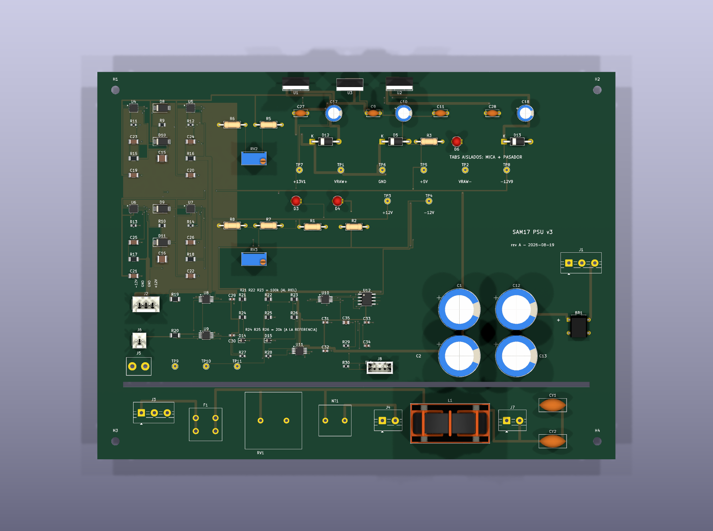

# PSU v3 — la primera que se construye

**Estado:** Fases A (decisiones), B (esquemático), C (placa) y D (chasis)
cerradas. La placa está **ruteada y con DRC en cero**; falta la validación —
que empieza cuando exista la placa física.

> **La v1 y la v2 son diseños de papel.** La v1 se abandonó el 2026-08-17 sin
> fabricar; la v2 llegó a tener gerbers, BOM y CPL generados y tampoco se pidió.
> Ésta es la tercera y la primera que existe como objeto. De ahí su constraint:
> **lo que no quede decidido sale con huella y `DNP`, nunca con una v4.**

## Qué cambia respecto de la v2

La topología de regulación **no se toca**: sigue siendo la cascada de dos etapas
por riel, con las mismas piezas y los mismos setpoints. Lo que cambia es todo lo
que la rodea.

| | v2 | v3 | por qué |
|---|---|---|---|
| **Disipación** | 3 disipadores Fischer individuales | los tabs contra la pared del chasis | Tj de `U2`: 101 → **62 °C** |
| **Colocación de los TO-220** | diagonal opuesta a la isla SMD | en fila sobre un canto, **tabs coplanares** | lo impone la pared, no la estética |
| **Protección** | crowbar en +12 V | **ninguno, en ningún riel** | #118 |
| **Fusible de red** | `F1` en la placa | en el **IEC C14 de la pared** | #130 |
| **Instrumentación** | 6 test points | test points + **isla de telemetría** | spec §4 |

### La protección: no se sustituye, se retira

El crowbar de la v2 protegía contra un fallo del regulador que pusiera VRAW en
el bus. Al rehacer el análisis contra el BOM real (§16.8, reescrita) salieron dos
cosas a la vez:

- **La cascada ya protege sola.** Ningún fallo *simple* pone más de ±13,1 V en el
  bus, que está dentro del máximo absoluto de todos los chips del instrumento. Y
  el pre-regulador no arrastra al post: los LT3045/LT3094 aguantan los 20,54 V de
  VRAW con 1,46 V de margen (ADI Rev. D p.2 / Rev. B p.3).
- **El lazo del crowbar no cerraba con ningún SCR.** El fusible tiene que abrir
  para que el corto sirva de algo, y `F1` subió de 250 mA a 1,6 A en la v2 —
  correctamente, por el inrush del toroide. A los 2,79 A que refleja el fallo,
  IEC 60127 **no obliga** a un fusible T a abrir. El SCR muere en 140 µs; el
  fusible tarda entre 1,3 y 3,9 s.

> El fallo del guardaespaldas es peor que el peligro del que cuida.

Lo que **no** se va con el crowbar: **un TR1 sin fusible térmico embebido no se
compra.** Los 642 W de cualquier corto del secundario son la cuenta que ni `F1`
ni un crowbar cubren, y esto pasa dentro de un recinto cerrado.

## Las puertas

Quince, todas ejecutables, todas recogidas por `hardware/tools/gates.py` sin
tener que apuntarlas en ninguna lista — se añade una escribiendo el fichero,
nunca ampliando un índice que alguien puede olvidar:

| Puerta | Qué pregunta |
|---|---|
| [`check_absmax.py`](check_absmax.py) | ¿sobreviven los módulos a un fallo de regulador? Y antes de eso: ¿la cascada **existe**? |
| [`check_telemetria.py`](check_telemetria.py) | ¿el instrumento sobrevive a medir? Divisores, shunts, direcciones I²C y alimentaciones contra el límite garantizado de cada datasheet |
| [`kicad/check_bom.py`](kicad/check_bom.py) | ¿el BOM y la hoja tienen los mismos designadores? |
| [`kicad/check_netlist.py`](kicad/check_netlist.py) | ¿la isla está **cableada** como dice el contrato? Shunts en serie, divisores en el sentido correcto, masas sin un nodo común |
| [`kicad/check_pcb.py`](kicad/check_pcb.py) | ¿la placa **commiteada** está colocada como dice el script, y su cobre guardado cumple cruces, **masa en árbol sin ni un bucle —vías incluidas—**, cero conexiones abiertas, cero muñones colgando, pista–pad y separación de vías? También vigila la barrera de red, la isla de referencia, la diagonal del lazo y los tres tabs contra la pared |
| [`kicad/check_pcb_mutations.py`](kicad/check_pcb_mutations.py) | ¿las siete mutaciones históricas —pieza movida, cruce, bucle de masa en una capa, bucle que cruza de capa por una vía, muñón colgando, pista sobre pad y vía duplicada— siguen poniendo roja la puerta completa, **cada una por separado y con el número de líneas que su fila declara**? Más los umbrales del filtro de cajas, los rechazos de cobre que no sabe leer, y que una vía de masa quitada deja una conexión abierta |
| [`check_paquete.py`](check_paquete.py) | ¿el paquete de fabricación commiteado es **el de esta placa**? Cruza los trazos de los dos gerbers de cobre contra las pistas, y los taladros del Excellon contra las vías más los pads pasantes. Uno a uno, no por conteo |
| [`check_paquete_mutations.py`](check_paquete_mutations.py) | ¿tocar la placa y **no** regenerar el paquete pone roja esa puerta? Pista nueva, vía nueva, vía podada y pista movida a mano |
| [`check_generador.py`](check_generador.py) | ¿el ruteador escrito a mano sigue corriendo, y produce el cobre que la placa lleva? Corre las cuatro rutas de forma fija en 0,8 s —el laberinto son 180 s y se queda fuera, declarado— y cruza cada tramo y cada vía contra el `.kicad_pcb` |
| [`check_generador_mutations.py`](check_generador_mutations.py) | ¿una aserción rota del generador sale como FALLO con su texto, y un desfase entre guion y placa se ve por los dos lados? |
| [`check_fab.py`](check_fab.py) | ¿lo que se **manda a fábrica** dice lo mismo que la placa? A JLC no se le sube el `.kicad_pcb`: se le suben seis gerbers y un drill que ninguna otra puerta mira |
| [`check_huellas.py`](check_huellas.py) | ¿las huellas dibujadas a mano son las de la **pieza real**? Es geometría, no conectividad: no la ve el ERC, ni el DRC, ni la netlist |
| [`check_red_chasis.py`](check_red_chasis.py) | ¿la red entra por una pieza que **existe**, con un solo fusible, y el chasis tiene su recorte? |
| [`check_bringup.py`](check_bringup.py) | ¿la placa física mide lo que el diseño predijo? 55 puntos con su criterio y su cita |
| [`valle_budget.py`](valle_budget.py) | ¿el valle de VRAW aguanta el peor caso? ngspice, no una tabla |

`check_bom.py` y `check_netlist.py` se reparten huecos a propósito: el primero
pasaría en verde con SDA y SCL cambiados —no falta ni sobra un componente, sobra un cable
en el sitio equivocado— y por eso existe la de netlist.

Y `check_pcb.py` cierra uno más viejo. `gates.py` sabía buscar el Python de
KiCad desde hace versiones (`necesita_kicad` / `PY_KICAD`) y **no había un solo
fichero que lo usara**: ni la v1 ni la v2 tuvieron nunca la placa dentro de la
suite. Todas sus comprobaciones —barrera de red incluida— corrían solo cuando
alguien se acordaba de ejecutar `build_pcb.py` a mano.

Lee el `.kicad_pcb` que está en git, no el que acaba de generarse. La
diferencia es lo que caza una pieza movida en la GUI y guardada: a partir de
ahí el fichero que va a fábrica y el script que dice cómo se colocó dejan de
ser el mismo diseño.

## La telemetría

Cinco chips, ~12 USD, sin tocar la regulación:

| Magnitud | Pieza | Dir. |
|---|---|---|
| Tensión + corriente de +12 V | `U8` INA226 | 0x40 |
| Tensión + corriente del +5 V de `U3` | `U9` INA226 | 0x41 |
| −12 V, VRAW+ y VRAW− (solo tensión) | `U10` ADS1115 | 0x49 |
| Temperatura del aire del recinto | `U11` TMP1075 | 0x48 |
| Barrera GNDA / GNDD | `U12` ISO1541 | — |

Tres cosas que no son obvias y que decidieron el diseño:

**El valle de VRAW es el número que compra este chip.** Es contra el que se
pelearon los 9400 µF, el toroide de 120 VA y los 13,6 V de `U1`, y hasta ahora
sólo existía simulado.

**El +5 V se mide por su tensión más que por su corriente.** Ese nodo es la
*referencia* de los divisores de los canales negativos, así que medirlo hace que
la lectura de −12 V se autocalibre contra el mismo riel del que cuelga su
divisor.

**El riel negativo no lleva corriente porque no puede.** El modo común de entrada
del INA226 tiene mínimo garantizado −0,3 V (TI SBOS547C p.4): a −12 V está 40
veces fuera. Medirlo exigiría un dominio aislado entero. No es una comodidad que
se dejó fuera, es un máximo absoluto.

### El divisor

Los tres canales comparten **dos valores** al 0,1 %: 100 k y 20 k, atenuación
**1/6** en los tres. El 1/6 no es redondo por gusto — es el que hace que el pin
del ADC llegue a 0,000 V justo cuando VRAW− llega a −25 V, la tensión nominal de
los propios condensadores de bulk. **La cadena de medida no falla antes que la
pieza que mide.**

> **Invariante, y va en la seda:** el 100 k mira siempre al riel medido, el 20 k
> siempre a la referencia. Mal *dibujado* lo caza `check_netlist.py`; mal
> *poblado* (un 20 k en la huella del 100 k, las dos son 0805 idénticas) no lo
> caza nadie.

## Un rótulo que estuvo mal desde la v1

Al leer el netlist de esta versión salió que `J2`, el bus de ±12 V hacia los
módulos, tiene **el pin 1 en −12 V y el 4 en +12 V** — mientras el rótulo del
conector y el `bom.csv` decían `+12 / GND / GND / −12`, o sea lo contrario.

No hay fallo eléctrico: el esquemático y la bus board coinciden, y el
`check_netlist.py` de la bus board lo afirma («par 1 = franja roja = −12 V»,
«igual que J2 del módulo 1»). Lo que estaba mal era el **rótulo**, en el sitio
exacto donde más daño hace: quien montara el mazo leyendo esa columna habría
metido ±12 V al revés en los seis módulos. Corregido aquí y en `design-notes`
§10.4; la v1 y la v2 quedan congeladas con el suyo mal.

## La placa

**200 × 150, girada respecto de la v1 y la v2.** No es preferencia: el eje largo
de la PCB va a lo ancho del case, 200 mm de los 528 disponibles contra solo 150
de los 223 de fondo. Al revés no cabe.



Tres cosas de esta placa las decide el chasis, no el layout:

**Desaparecen los disipadores.** La v1 y la v2 reservaban 42 × 38,1 mm por cada
TO-220 para su Fischer individual. Aquí el disipador es la pared, así que esos
3 × 1600 mm² vuelven al layout — y por eso una placa más corta en un eje sigue
sobrándole sitio.

**La fila de TO-220 no se elige aquí.** Su X la declara `chasis_to220_x` /
`chasis_to220_paso` en `case/cad/params.scad`, y `build_pcb.py` **la lee de ese
fichero**. El canto de la placa y la pared son la misma cota vista desde dos
lados; copiar el número sería crear dos verdades que se separan en silencio el
día que una se mueva.

**El cuerpo de los tres cuelga fuera de la placa**, hacia la pared. Los 10 mm
entre el canto y la cara interior son el sitio del conformado de patas. Las
puertas de margen y de solape tienen esa excepción declarada: a esos tres se les
mide por los pads.

### Lo que la colocación tuvo que resolver

| | |
|---|---|
| La franja de red no cabía | El MOV mide 23,1 mm y la banda bajo la barrera tenía 18. La barrera baja de y=128 a y=121 |
| `L_SMPS` y `N_SMPS` no estaban en `NETS_RED` | Son la salida del choke hacia `J7`: **230 V igual que antes de entrar**. Sin ellas, `es_red()` las daba por SELV. Lo cazó la propia puerta de fuga midiendo 5,50 mm entre los dos pines de `CY2` — que son justo los que un Y2 existe para puentear |
| El filtro de modo común estaba al final de la fila | Y su retorno a PE es *todo el mecanismo* (§18.7: el choke sube impedancia, los Y dan el camino de vuelta). Movido junto al fusible, donde pincha `L_F`: el lazo se parte por la mitad |
| `J3` a 5,83 mm del tornillo `H3` | Ese tornillo va al chasis, o sea a PE. La fuga de 6 mm es exactamente la que hay que exigir ahí |

### La telemetría y el lazo

`revisar_diagonal()` heredada exige ≥ 80 mm entre el lazo de rectificación y la
isla ultra (mide **93**). Se le añadió un segundo umbral, ≥ 30 mm hasta la isla
de telemetría (mide **40**), y el umbral más bajo tiene motivo: la isla ultra
defiende 0,8 µVrms; la telemetría mide con 16 bits sobre 4 V de fondo de
escala, ~60 µV por cuenta. Tres órdenes de magnitud de diferencia en lo que hay
que proteger. Lo que sí comparten es la razón de estar lejos: los divisores son
de 100 k, y un nodo de alta impedancia junto a un lazo rectificador recoge por
capacidad lo que no recogería uno de baja.

### Y el invariante llegó a la seda

El README de esta versión declaraba un hueco: el divisor mal *dibujado* lo caza
`check_netlist.py`, mal *poblado* (un 20 k soldado donde va el 100 k, las dos son
0805 idénticas) no lo caza nadie. Ahora hay dos líneas de serigrafía entre las
dos filas, que es donde mira quien las suelda:

```
R21 R22 R23 = 100k (AL RIEL)
R24 R25 R26 = 20k (A LA REFERENCIA)
```

Y el aviso que la v2 no necesitaba, porque allí cada TO-220 tenía su disipador
suelto y solo `U2` pedía mica: **`TABS AISLADOS: MICA + PASADOR`**. Aquí los tres
van contra la misma pared, que además es la referencia de PE, y dos de los tres
tabs están a VRAW+ y VRAW−.

## Documentación

| Fuente | Contenido |
|---|---|
| [spec 2026-08-18](../../../docs/superpowers/specs/2026-08-18-fuente-chasis-telemetria.md) | Chasis de acero, térmica y telemetría |
| [plan 2026-08-18](../../../docs/superpowers/plans/2026-08-18-fuente-v3-goat.md) | Las cinco fases |
| [notes/design-notes.md](../notes/design-notes.md) | §16.8 (protección), §16.5 (VRAW), §16.12 (+5 V) |
| [../v2/README.md](../v2/README.md) | La arquitectura de regulación, que aquí no cambia |

## El ruteo

**999 segmentos, 172 vías, DRC de `kicad-cli` en cero infracciones y cero
elementos sin conectar.** Al empezar la fase eran 48 infracciones y 126 sin
conectar.

> Las cifras bajaron de 1024 y 176 el 2026-09-02, en dos pasos.
>
> **#139 — el árbol tenía dos espiras que ninguna regla veía.** Tres pads de
> GND de `U11` comparten su rabito en F.Cu —uno cruza por encima de los otros
> dos— y cada uno bajaba con su propia vía a la misma costilla. Sobran dos
> bajadas y el cobre que iba a buscarlas. Quitar una arista que cierra un
> ciclo no desconecta nada: el ratsnest sigue en cero y el DRC también.
>
> **#280 — la corriente de rectificación daba la vuelta a la placa.** `J1.2`,
> la toma central del secundario, caía por cercanía en la costilla de `y=66` y
> los dos bulk en la de `y=99`; las dos sólo se tocan por el tronco en `x=11`.
> Cada pico de 2,5 A se iba 379 mm hasta el canto izquierdo y volvía,
> encerrando **57,49 cm²** contra un tope de 10,46 que sale del propio modelo
> de acoplo. Con `J1.2` en la costilla de los bulk el lazo queda en
> **2,44 cm²** — mejor que la v1. Detalle en `design-notes.md` §18.2, y la
> medida es ejecutable: `simulations/power/hum_loop.py`.

El reparto no es por longitud sino por **quién define la forma de la pista**:

| a mano | por qué no lo puede decidir un camino más corto |
|---|---|
| `rutear_gnd` | GND es un **árbol**, no un plano: un plano crea una espira de 100 Hz alrededor del puente |
| `rutear_red` | los 230 V van en carriles con 2,5 mm de aire, y eso lo manda el aislamiento |
| `rutear_rieles` | dónde se suelda el sense de `OUTS` decide **qué tensión queda regulada** |

Las otras 126 conexiones —I²C, los tres divisores, el lazo de rectificación,
+5 V, las SET/ILIM locales— solo piden no cruzarse con nada, y eso lo hace
mejor un BFS de Lee que yo. **El ruteador ya estaba en el repo**:
`hardware/tools/maze.py`, escrito para el módulo 2, probado con su propia
demo, y sin que lo importara ni la v1 ni la v2 ni esta versión.

### Lo que costó, medido

| | |
|---|---|
| Rejilla de 0,1 mm y no de 0,25 | con 0,25 el riel de +5 V dejaba 5 pines al aire, y los cinco eran el pin del **medio** de un MSOP |
| `via_ok` en O(1) | preguntarle a `_hay_sitio()` —que recorre los 310 pads— una vez por nodo no terminaba en diez minutos |
| El clearance tenía **tres** verdades | `CLEARANCE_MM` = 0,127, `m_MinClearance` = 0,127 y la netclass en el 0,2 de fábrica, que es contra la que compara el DRC. 34 infracciones con las puertas propias en verde |
| El pasillo entre dos pines de 0,45 mm | mide **0,196 mm** y no admite margen de cortesía: la rejilla redondeaba hacia fuera y se comía las dos únicas celdas |
| GND va la **última** | iba primera y sus vías se posaban en el pasillo por el que luego salía un pin de MSOP. Su forma la fijan `GND_TRONCO_X` y `GND_COSTILLAS`; lo único que se adapta es dónde cae cada vía, que es justo lo que debe adaptarse |

Y una que no es de ruteo: **U7.9 no cabía por ningún lado**. Con 0,45 mm de
paso, una vía de 0,6 mm en la banda de un pin invade los carriles de sus dos
vecinos —pide 0,527 mm y hay 0,45—, y alargar el rabito recto solo empeora,
porque cruza más cosas. Se resolvió **girando**, como haría un layouter: sale,
pasa de largo las escapadas de sus vecinos, y baja de capa ya fuera de la
fila. Ninguna separación se aflojó.

## Tres cosas que el ruteo destapó y no eran del ruteo

**La isla de referencia se rellenaba a 140 mm de donde tenía que estar.** El
recorte circular de `H4` se escribió cuando la placa medía 150 × 200 y el
taladro caía dentro de `ISLA_REF`; al girarla a 200 × 150 se fue a (193, 143)
y el recorte se quedó — un agujero fuera de su propio polígono. La zona de
3256 mm² se rellenaba como **un trozo de 12,24 mm² alrededor del taladro**. De
ahí salían, los dos a la vez, el `isolated_copper` y los seis pads de GNDREF
sin conectar.

**`R6.2` no ha estado conectado en ninguna versión.** R6 y R8 son el mismo
divisor de ajuste a cada lado de la placa, con la misma huella y la misma
colocación, pero dibujados **espejados**: el pin que toca la referencia es el 2
en uno y el 1 en el otro. En la placa eso mandaba el pad de GNDREF de R6 a
x = 57,16, con la isla acabando en 54. Es el fondo del divisor de ajuste de
`U1`, el pre-regulador de +12 V. Se arregló girando el símbolo 180° — el
cableado del esquemático no se mueve y la huella tampoco, un resistor es
simétrico — y `netdiff` lo cazó en dos líneas.

> No se vio antes porque `revisar_isla_referencia()` solo mira **pistas** de
> GNDREF, y hasta esta tanda no había ninguna. Era verde por vacía, que es
> exactamente lo que dice el Principio VIII de la constitución.

**El EP de `U6`/`U7` no llegaba a ningún sitio** — salía 2,5 mm y ahí se
quedaba, con la entrada de los dos LT3094 conectada solo por sus pines 1-3 —
y **`F1` tiene dos clips por lado**: el portafusible tiene dos posiciones y
solo una estaba cableada.

## Dos trampas de la herramienta, con fecha

**`ZONE_FILLER.Fill()` hace SEGFAULT** desde el Python de KiCad 10.0 con esta
placa ya ruteada (2026-08-21: exit 139, sin traceback, con 1042 segmentos;
con 995 todavía pasaba). No es la zona ni su geometría — se probó con el
polígono ya arreglado y se sigue cayendo. El relleno lo hace `kicad-cli pcb
drc --refill-zones --save-board`, que es el mismo código fuera del proceso, y
por eso es un **paso del pipeline de fabricación**, no un detalle.

**Y la netclass se escapa por dos sitios.** Escribirla solo en el `.kicad_pro`
no basta: `kicad-cli --save-board` la devuelve al 0,2 de fábrica, porque
guarda lo que la **placa** lleva en memoria y no lo que hubiera en el fichero
de proyecto. Va escrita en el objeto `board`.

## Lo que falta
- ~~**Fase D — chasis.**~~ **Cerrada.** El toroide tiene hoja del fabricante
  (Ø93 × 46, 1,20 kg) y el chasis de acero existe en `case/cad/` con sus tres
  DXF de corte y su puerta. Queda abierto solo el presupuesto de la pantalla
  electrostática, que depende de Talema.
- **Fase E — validación.** El LNA de medida (#58) y el bring-up: el valle real de
  VRAW y el número de ruido real, los dos por primera vez.
- **El recorte del IEC en la chapa** (#130, lo único que queda de él). La pieza
  está elegida y con hoja — Schurter `KM00.1105.11`, §19.4 — y
  `check_red_chasis.py` reclama en HUECO los `chasis_iec_ancho = 28` y
  `chasis_iec_alto = 47` que le faltan a `case/cad/params.scad`. No bloquea la
  PCB; sí la chapa, y una chapa cortada no se deshace.
- **El fondo del faston `J5`** (§19.3): la tabla de Vogt da el paso y el
  taladro, pero el eje Y en planta necesita el dibujo acotado. El courtyard
  reserva 8,0 mm sin contrastar.
